<p class="guide-top"><strong>USER GUIDE</strong><span class="ver">버전 : 1.50.28</span></p>

# AI챗 기억 도우미

## 사용 설명서

AI챗 기억 도우미를 사용해 주셔서 감사합니다.
도우미는 크랙(crack.wrtn.ai) 롤플레이에서 AI가 지난 일과 설정을 잊지 않도록 돕는 Tampermonkey 스크립트입니다.

롤플레이가 길어지면 AI는 앞의 이야기를 점점 잊습니다.
도우미는 턴을 세다가 정리할 때가 되면 알려 드리고, 지난 이야기를 경과로 정리해 크랙 장기기억에 넣도록 돕습니다.
또한 상태창이 망가지지 않았는지 점검하고, 인물과 장소 같은 설정을 보낼 때마다 함께 붙여 줍니다.
새 AI 답이 써 둔 설정과 어긋나 보이면 화면 위에 알림을 띄웁니다.

> **세 줄 요약**
> 1. 턴을 세다가 정리할 때가 되면 배지 색으로 알려 드립니다.
> 2. 정리 요청 글을 만들어 쓰시는 AI(Claude, ChatGPT 같은 것)에 붙여 넣고, 그 답을 장기기억에 넣습니다. 도우미가 AI를 직접 부르지 않아서 비용이 들지 않습니다.
> 3. 인물·장소 설정과 지금 관계를 보낼 때 함께 붙여, AI가 잊지 않게 합니다.
>
> 처음엔 자주 쓰는 기본 기능만 보입니다. 나머지는 메뉴 맨 아래 **고급 기능 열기**를 누르면 한꺼번에 나옵니다.
> 처음이시면 **04 처음 시작하기**부터 보십시오. 설치한 그대로 써도 되고, 필요한 것만 켜면 됩니다.

올바르게 사용하시려면 이 설명서의 **01 용어 안내**를 먼저 읽어 주십시오.
설명서에 나오는 이름은 패널에 보이는 이름과 같습니다.

* 패널의 기능 이름 옆 **ⓘ** 아이콘을 누르면 그 기능의 짧은 설명을 바로 볼 수 있습니다.
* 패널의 **사용법 보기**로 열면 PC에서는 왼쪽 **차례**, 휴대폰에서 오른쪽 아래 **차례** 단추로 항목을 바로 찾아갈 수 있습니다. 차례 칸에 낱말을 쓰면 그 낱말이 든 항목만 남습니다.

<!-- toc -->
**차례**

- [01 용어 안내](#01-용어-안내)
- [02 설치 및 업데이트](#02-설치-및-업데이트)
- [03 각 부분 명칭](#03-각-부분-명칭)
- [04 처음 시작하기](#04-처음-시작하기)
- [05 경과 정리하기](#05-경과-정리하기)
- [06 정리 규칙](#06-정리-규칙)
- [07 상태창 관리](#07-상태창-관리)
- [08 보낼 때 붙이기](#08-보낼-때-붙이기)
- [09 답 점검](#09-답-점검)
- [10 내 글 넣기](#10-내-글-넣기)
- [11 설정](#11-설정)
- [12 되돌리기](#12-되돌리기)
- [13 주의사항](#13-주의사항)
- [14 문제가 생겼을 때](#14-문제가-생겼을-때)
- [15 업데이트 내역](#15-업데이트-내역)
- [16 도움 받은 곳](#16-도움-받은-곳)
<!-- /toc -->

---

## 01 용어 안내

도우미 화면과 이 설명서는 아래 낱말을 같은 뜻으로만 씁니다.

### 화면

| 용어 | 뜻 |
|---|---|
| 도우미 | 이 스크립트(AI챗 기억 도우미)입니다. |
| 배지 | 크랙 채팅 화면 구석에 늘 떠 있는 작은 알림입니다. 예: `경과 +6턴` |
| 패널 | 배지를 누르면 열리는 도우미 창입니다. |
| 머리줄 | 패널 맨 위 줄입니다. 사용법 보기, 테마, 진단 복사, 닫기 단추가 있습니다. |
| 작품 줄 | 머리줄 아래 줄입니다. 작품 이름, 내 캐릭터 이름, 이 작품 설정 요약이 보입니다. 잘려 보이면 **자세히**를 눌러 다 봅니다. |
| 메뉴 | 패널을 기능별로 나눈 목록입니다. 장기기억 정리, 상태창 관리, 보낼 때 붙이기, 설정 넷입니다. PC에서는 패널 왼쪽에 늘 보이고, 휴대폰이나 좁은 창에서는 메뉴 단추를 눌러 엽니다. |
| 작은 메뉴 | 메뉴 아래에 들여 쓴 항목입니다. 예: 상태창 관리 아래의 점검 결과 |
| 메뉴 단추 | 휴대폰이나 좁은 창에서 보이는 ☰ 단추입니다. 지금 보는 메뉴 이름이 함께 적혀 있습니다. |
| 접는 칸 | 제목을 누르면 펴지고 접히는 칸입니다. 하나를 펴도 다른 칸은 닫히지 않습니다. |
| 도움말 아이콘 | 기능 이름 옆의 ⓘ입니다. 짧은 설명이 뜹니다. |

### 대화

| 용어 | 뜻 |
|---|---|
| 내 입력 | 내가 크랙에 보내는 글입니다. |
| 응답 | 크랙 AI가 보낸 글입니다. |
| 응답 본문 | 응답에서 상태창을 뺀 이야기 부분입니다. |
| 턴 | 내 입력 한 번과 응답 한 번입니다. |
| 턴 표시 | 응답(주로 상태창)에 적힌 턴 번호입니다. 예: `턴:12` |
| OOC | 이야기 밖에서 AI에게 하는 말입니다. 예: `OOC: 상태창에 체력을 넣어 줘` |

### 장기기억과 경과

| 용어 | 뜻 |
|---|---|
| 장기기억 | 크랙의 장기기억 기능입니다. 여러 칸으로 되어 있습니다. |
| 장기기억 칸 | 장기기억 하나하나입니다. 제목과 내용이 있습니다. |
| 자동 칸 | 크랙이 만든 장기기억 칸입니다. 도우미는 이 칸에 경과를 넣습니다. |
| 직접 추가한 칸 | 내가 크랙에서 직접 넣은 장기기억 칸입니다. 도우미는 처음 설정으로는 이 칸을 고치지 않습니다. |
| 경과 | 지난 이야기를 정리한 글입니다. 장기기억 칸 하나에 경과 하나가 들어갑니다. |
| 경과 표시 | 경과 내용 맨 끝에 붙는 표시입니다. 예: `〔경과2 · 턴7~12〕` 도우미는 이 표시로 어디까지 정리했는지 압니다. |
| 정리 요청 | 경과를 써 달라고 AI에게 보내는 글입니다. 요청 파일(.txt)이나 요청 글로 만듭니다. |
| 정리 AI | 정리 요청을 보내는 크랙 밖의 AI입니다. 예: Claude, ChatGPT, Gemini |
| AI 답 | 정리 AI가 정리 요청을 받고 써 준 답입니다. |

### 상태창과 붙이기

| 용어 | 뜻 |
|---|---|
| 상태창 | 응답 끝에 코드 블록으로 붙는 표입니다. 예: 날짜, 장소, 체력, 소지품 |
| 상태창 코드 블록 이름 | 상태창 코드 블록의 이름입니다. 응답 속 상태창이 ` ```Info `로 시작하면 `Info`입니다. |
| 제작자 형식 | 작품을 만든 사람이 정한 상태창 모양입니다. 도우미가 대화에서 읽어 기준으로 삼습니다. |
| 로어 | 작품의 고정 설정입니다. 예: 인물, 장소, 물건, 규칙 |
| 지금 사실 | 이 채팅에서 지금 맞는 사실입니다. 인물 사실, 안 끝난 이야기, 누가 무엇을 아는지, 호칭과 말투, 중요한 물건으로 나눠 씁니다. |
| 내가 쓴 줄 | 지금 사실에서 인물 사실이 아닌 종류를 직접 쓰거나 고친 줄입니다. AI 답이 고치거나 끝내지 못하고 제안만 합니다. |
| 붙이는 블록 | 보내기 직전 내 입력 앞에 붙는 글 묶음입니다. 로어, 지금 사실, 장기기억이 들어갑니다. **AI 답에 숨겨 붙이기**<strong>(고급)</strong>를 켜면 바로 앞 AI 답 끝에 화면에 안 보이게 붙습니다. |

### 설정

| 용어 | 뜻 |
|---|---|
| 작품 설정 | 작품마다 따로 저장하는 설정입니다. 예: 턴 세는 법, 상태창 형식 |
| 공통 설정 | 모든 작품에 같이 쓰는 설정입니다. 예: 정리 알림 턴, 경과 글자 수 |
| 되돌리기 | 방금 바꾼 것을 바꾸기 전으로 돌리는 단추입니다. |
| 저장 전으로 | 저장한 설정을 저장하기 전 값으로 돌리는 단추입니다. |

---

## 02 설치 및 업데이트

### 설치

1. 브라우저에 [Tampermonkey](https://www.tampermonkey.net/)를 설치합니다.
   휴대폰에서는 Tampermonkey를 쓸 수 있는 브라우저(예: 안드로이드 Firefox, Kiwi)가 필요합니다.
2. 아래 링크를 엽니다. Tampermonkey 설치 화면이 뜨면 <strong>설치(Install)</strong>를 누릅니다.
   **[AI챗 기억 도우미 설치하기](https://raw.githubusercontent.com/LikeGale/crack-chat-helper/main/crack-progress-helper.user.js)**
3. 크랙 채팅 화면을 새로 고칩니다. 화면 구석에 배지가 뜨면 설치가 끝난 것입니다.

### 업데이트

위 링크로 설치했다면 새 버전이 나올 때 Tampermonkey가 저절로 업데이트합니다.
바로 받으려면 Tampermonkey 메뉴의 <strong>대시보드(Dashboard)</strong>를 열고 **설치된 유저스크립트(Installed Userscripts)** 목록에서 도우미 줄의 <strong>업데이트 확인(Check for updates)</strong>을 누르십시오.
Tampermonkey 아이콘 메뉴의 <strong>유저스크립트 업데이트 확인(Check for userscript updates)</strong>을 눌러도 됩니다.

* 처음 **사용법 보기**를 누르면 Tampermonkey가 `raw.githubusercontent.com`에 접속해도 되는지 묻습니다. <strong>항상 허용(Always allow)</strong>을 누르십시오.
* 스크립트를 지웠다가 다시 설치하면 저장해 둔 설정이 사라집니다. 동기화를 연결해 두었다면 다시 연결해 작품 설정, 로어, 지금 사실, 공통 설정을 되찾을 수 있습니다(11 설정 › 데이터 관리 › 동기화).
* 브라우저의 시크릿 창에서는 Tampermonkey가 설정을 남기지 않을 수 있습니다. 아래처럼 바꾼 뒤 열린 시크릿 창을 모두 닫으십시오.
  1. **대시보드(Dashboard)** › **설정(Settings)** 탭을 엽니다.
  2. 맨 위 <strong>설정 모드(Config mode)</strong>를 <strong>고급(Advanced)</strong>으로 바꿉니다.
  3. **보안(Security)** 항목의 <strong>시크릿 모드 데이터 저장(Store data in incognito mode)</strong>을 <strong>영구(Permanent)</strong>로 바꿉니다.

---

## 03 각 부분 명칭

### 배지


① **배지**: 마지막으로 정리한 뒤 지난 턴 수를 보여 줍니다. 누르면 패널이 열립니다.

| 모양 | 뜻 |
|---|---|
|  | 보통입니다. |
|  | 정리할 때가 가까워졌습니다. 정리 알림이 30턴이면 25턴부터 노랗게 바뀝니다. |
|  | 정리할 때가 지났습니다. 빨갛게 천천히 깜빡입니다. |
| 빨간 점 | 최근 상태창이 형식에서 벗어났습니다. **상태창 관리** 메뉴를 확인하십시오. |
| 점검 N | 새 AI 답에 확인해 볼 곳이 N개 있습니다. **답 점검** 메뉴에서 보면 사라집니다. |

* 배지는 끌어서 옮길 수 있고, 옮긴 자리를 기억합니다. 키보드로는 배지를 고른 뒤 화살표 키로 옮깁니다.
* 다른 채팅으로 옮기면 그 채팅을 기준으로 다시 셉니다.

### 패널

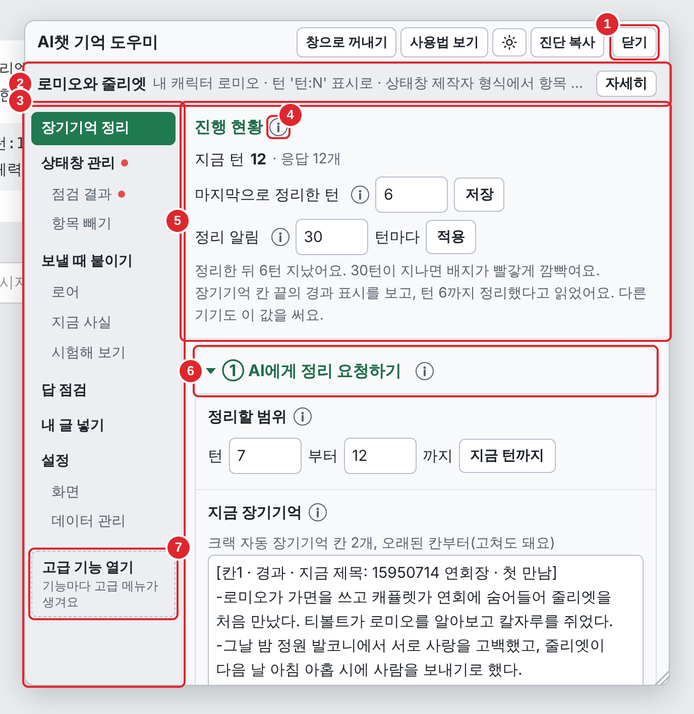

1. **머리줄 단추**: 창으로 꺼내기(PC), 사용법 보기, 테마, 진단 복사, 닫기
2. **작품 줄**: 작품 이름, 내 캐릭터 이름, 이 작품 설정 요약. 잘려 보이면 오른쪽 **자세히**를 누릅니다.
3. **메뉴**: 장기기억 정리, 상태창 관리, 보낼 때 붙이기, 답 점검, 내 글 넣기, 설정과 그 아래 작은 메뉴. 누르면 오른쪽 내용이 바뀝니다. 패널을 좁히면 메뉴가 숨고 **메뉴 단추**가 생깁니다.
4. **도움말 아이콘**: 누르면 짧은 설명이 뜹니다.
5. **진행 현황**: 지금 턴, 마지막으로 정리한 턴, 정리 알림
6. **접는 칸**: 제목을 누르면 펴지고 접힙니다. 펴 둔 칸은 기기마다 기억합니다.
7. **고급 기능 열기**: 누르면 고급 메뉴가 한꺼번에 생깁니다. 아래 **기본 기능과 고급 기능**을 보십시오.

| 머리줄 단추 | 하는 일 |
|---|---|
| 창으로 꺼내기 | 패널을 브라우저 밖의 따로 된 창으로 꺼냅니다. PC의 크롬·엣지에서만 보입니다. |
| 사용법 보기 | 이 설명서를 새 창에서 엽니다. 파일로 받으려면 설명서 오른쪽 아래(PC는 왼쪽 차례 칸 위)의 **내려받기**를 누릅니다. |
| 테마 아이콘 | 누르면 아이콘이 알리는 테마로 바뀝니다. 밝게일 때는 달(누르면 어둡게), 어둡게일 때는 모니터(누르면 기기 설정 따라가기), 기기 설정을 따라갈 때는 해(누르면 밝게)가 보입니다. |
| 진단 복사 | 고장 원인을 찾을 때 쓰는 정보를 복사합니다. 공통·작품·로어·이 채팅의 설정 값도 모두 들어갑니다. 대화 내용, 이름, 내가 쓴 글은 들어가지 않습니다(글자 수만). |
| 닫기 | 패널을 닫습니다. |

* 휴대폰처럼 패널이 좁으면 머리줄이 두 줄이 됩니다. 윗줄에는 이름·버전과 **닫기**, 아랫줄에는 나머지 단추가 있습니다.

### 기본 기능과 고급 기능

처음엔 자주 쓰는 기본 기능만 메뉴에 보입니다. 메뉴 맨 아래 **고급 기능 열기**를 누르면 고급 메뉴가 한꺼번에 생깁니다.

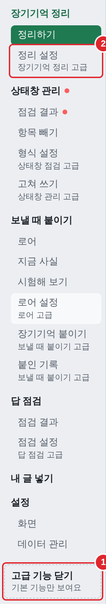

① **고급 기능 열기 / 고급 기능 닫기**: 한 번 누르면 열리고, 다시 누르면 숨습니다. 연 상태는 기기마다 기억합니다.
② **고급 메뉴**: 원래 기능 바로 아래에 붙고, 이름 밑에 어느 기능의 고급 기능인지 적혀 있습니다.

| 기능 | 기본 메뉴 | 고급 메뉴 |
|---|---|---|
| 장기기억 정리 | 정리하기(진행 현황, ① 정리 요청, ② AI 답 넣기) | **정리 설정**: 턴 세는 법, 점검할 표현, 직접 추가한 장기기억, 찾을 말, 정리 규칙, 장기기억 백업 |
| 상태창 관리 | 점검 결과, 항목 빼기 | **형식 설정**(상태창 점검 고급), **고쳐 쓰기**(상태창 관리 고급) |
| 보낼 때 붙이기 | 로어, 지금 사실, 시험해 보기 | **로어 설정**(로어 고급), **장기기억 붙이기**와 **붙인 기록**(보낼 때 붙이기 고급) |
| 답 점검 | 점검 결과 | **점검 설정**(답 점검 고급) |
| 내 글 넣기 | 묶음, 내 장기기억 칸, 내 유저노트 | 없음 |
| 설정 | 화면, 데이터 관리 | 없음 |

* 고급 기능을 닫아도 켜 둔 설정은 그대로 일합니다. 메뉴에서만 숨깁니다.
* 고급 메뉴를 보던 중에 닫으면 그 기능의 첫 기본 메뉴로 옮깁니다.
* 이 설명서에서 <strong>(고급)</strong>이라고 적힌 것은 고급 기능을 열어야 보입니다.

### 도움말 아이콘

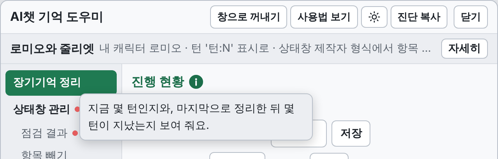

* PC에서는 아이콘에 마우스를 올리면 설명이 뜨고, 떼면 사라집니다. 누르면 설명이 그대로 남습니다.
* 휴대폰에서는 아이콘을 누르면 설명이 뜹니다. 다시 누르거나 다른 곳을 누르면 닫힙니다.
* Esc 키를 누르면 떠 있는 설명부터 닫힙니다.

### 열고 닫기

* **PC**: 머리줄을 잡고 끌면 패널이 옮겨집니다. 오른쪽·아래 가장자리나 오른쪽 아래 귀퉁이를 끌면 크기가 바뀝니다. 패널을 연 채로 채팅을 쓸 수 있고, **Esc**나 **닫기**로 닫습니다.
* **휴대폰**: 패널이 화면 아래에서 올라오고, **메뉴 단추**는 맨 아래에 있습니다. 누르면 메뉴가 펴지고, 고르면 다시 접힙니다. 위쪽 손잡이를 위아래로 끌면 높이가 바뀝니다. 패널 바깥이나 **닫기**, **뒤로가기**를 누르면 닫힙니다. PC에서 창을 좁혀 이 모양이 되었을 때도 **Esc**로 닫힙니다.
* 다른 채팅이나 다른 화면으로 옮기면 패널은 저절로 닫힙니다. 장기기억에 넣는 중일 때만 남습니다.

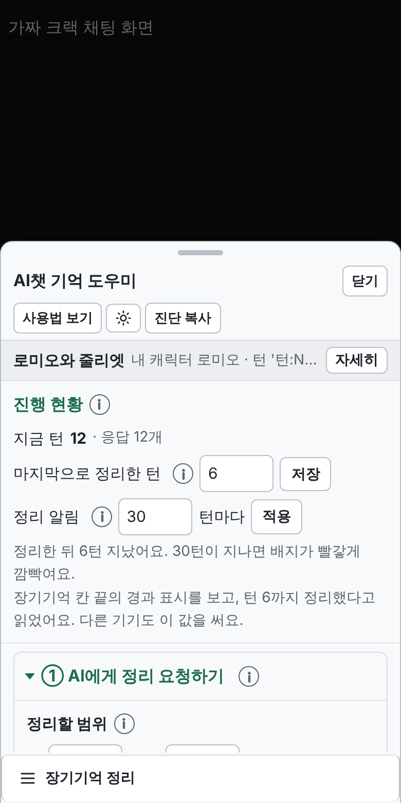

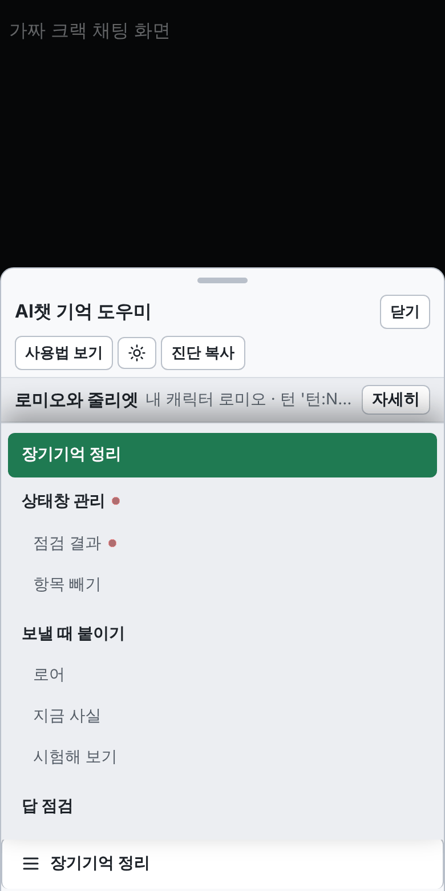

### 작품 줄 자세히 보기

휴대폰처럼 좁은 화면에서는 작품 줄이 잘려 끝에 '…'이 붙습니다.

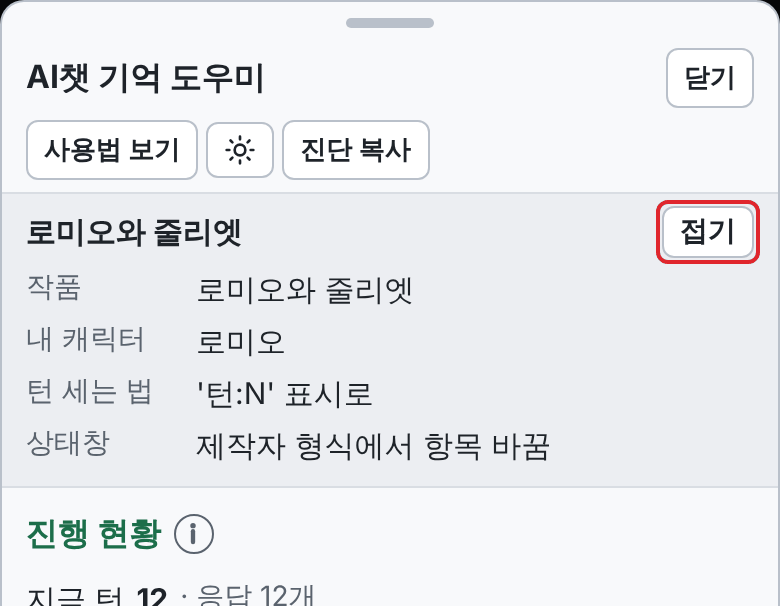

1. 작품 줄 오른쪽의 **자세히**(또는 잘린 요약 글자)를 누릅니다.
2. 작품, 내 캐릭터, 턴 세는 법, 상태창이 한 줄에 하나씩 모두 보입니다.
3. **접기**를 누르면 다시 한 줄로 돌아갑니다.

* 펼쳐 둔 상태는 기기마다 기억합니다. 처음 보는 작품은 짐작한 값을 확인하도록 펼쳐서 보여 줍니다.
* 다 보이는 넓은 화면에서는 **자세히**가 나오지 않습니다.

---

## 04 처음 시작하기

### 시작 순서

① 크랙에서 롤플레이 채팅을 엽니다. 화면 왼쪽 아래에 **배지**가 보입니다.

② 배지를 눌러 패널을 엽니다. 처음 보는 작품이면 도우미가 대화를 보고 턴 세는 법과 상태창을 짐작해 작품 줄에 펼쳐 보여 줍니다. 맞으면 **맞아요, 이대로 저장**을 누릅니다.

③ 평소처럼 롤플레이를 합니다. 배지가 노래지면 정리할 때가 가까운 것이고, 빨갛게 깜빡이면 정리할 때가 지난 것입니다.

④ 배지가 빨개지면 **05 경과 정리하기** 순서대로 정리를 요청하고, AI 답을 장기기억에 넣습니다. AI 답에는 새로 나온 인물·장소(로어)와 지금 사실도 함께 오니, 그 아래 **로어 목록에 넣기**와 **지금 사실에 넣기**도 누릅니다.

⑤ AI가 인물이나 장소 설정을 자꾸 잊으면 **보낼 때 붙이기 › 로어** 맨 위의 **보낼 때 로어 붙이기**를 켭니다. ④에서 넣은 로어가 이미 들어 있습니다.

* 여기까지만 해도 됩니다. 나머지 기능은 불편한 일이 생겼을 때 아래 표를 보고 켜십시오.

### 처음부터 켜진 것과 꺼진 것

설치하고 아무것도 바꾸지 않으면 아래처럼 되어 있습니다.
**작품마다**라고 적힌 것은 작품마다 따로 켜고 끄고, **기기마다**라고 적힌 것은 PC와 휴대폰에서 따로 정합니다.

<strong>(고급)</strong>이라고 적힌 것은 메뉴 맨 아래 **고급 기능 열기**를 눌러야 보입니다.

**장기기억 정리**

| 기능 | 처음 | 이럴 때 바꾸십시오 |
|---|---|---|
| 정리 알림 | 30턴마다 | 더 자주 정리하고 싶으면 숫자를 줄입니다. 작품마다. |
| 로어도 함께 받기 | 켜짐 | 로어를 쓰지 않으면 끕니다. |
| 지금 사실도 함께 받기 | 켜짐 (종류 다섯 모두) | 필요 없는 종류만 **보낼 때 붙이기 › 지금 사실 › 함께 받을 것**에서 끕니다. |
| 찾을 말도 함께 받기 <strong>(고급)</strong> | 꺼짐 | 오래전 일을 물어도 크랙이 그 장기기억을 못 찾을 때 켭니다. |
| 직접 추가한 장기기억도 고치기 <strong>(고급)</strong> | 꺼짐 | 직접 추가한 칸에도 경과를 넣고 싶을 때만 켭니다. |
| 경과 최대 개수와 글자 수 <strong>(고급)</strong> | 8개, 하나에 280자 | 경과가 너무 짧거나 길면 바꿉니다. |
| 경과 칸 상한 <strong>(고급)</strong> | 안 씀 (0) | 장기기억 칸이 너무 많아지면 숫자를 넣습니다. |

**상태창 관리**

| 기능 | 처음 | 이럴 때 바꾸십시오 |
|---|---|---|
| 상태창 점검 <strong>(고급)</strong> | 상태창이 보이는 작품은 켜짐, 없는 작품은 꺼짐 | 상태창이 없는 작품은 꺼진 채로 둡니다. 작품마다. |
| 항목 빼기에서 볼 턴 | 최근 5턴 | 오래 안 쓰는 물건을 더 길게 지켜보려면 늘립니다. |
| 상태창 고쳐 쓰기 <strong>(고급)</strong> | 꺼짐 | 상태창 항목 자체를 바꾸고 싶을 때 켭니다. 작품마다. |
| 바꾼 뒤 보낼 때 OOC로 알려 주기 <strong>(고급)</strong> | 꺼짐 | 고쳐 쓴 뒤 AI가 옛 모양으로 돌아갈 때 켭니다. |

**보낼 때 붙이기**

| 기능 | 처음 | 이럴 때 바꾸십시오 |
|---|---|---|
| 보낼 때 로어 붙이기 | 꺼짐 | 로어가 쌓이면 켭니다. 작품마다. |
| 한 번에 붙이는 로어 <strong>(고급)</strong> | 3개, 500자, 같은 로어는 5턴 쉼 | 붙는 글이 너무 길면 줄입니다. |
| 바로 앞 AI 응답에 이름이 나온 로어도 붙이기 <strong>(고급)</strong> | 꺼짐 | AI가 방금 쓴 인물도 설정을 잊을 때 켭니다. |
| 다른 말 속에 끼어 있는 낱말도 붙이기 <strong>(고급)</strong> | 꺼짐 | 대개 꺼 두는 편이 낫습니다. |
| 붙이는 글을 바로 앞 AI 답에 숨겨 붙이기 <strong>(고급)</strong> | 꺼짐 | 내 입력이 길어 붙는 글이 잘리거나, 크랙 기록의 내 입력을 깨끗하게 두고 싶을 때 켭니다. 작품마다. |
| 뜻으로도 찾기 <strong>(고급)</strong> | 꺼짐 | 이름을 말하지 않아도 붙이고 싶을 때 모델을 받아 켭니다. 기기마다. |
| 보낼 때 지금 사실 붙이기 | 켜짐 | 써 둔 줄이 없으면 아무것도 붙지 않습니다. 채팅마다. |
| 보낼 때 관련 장기기억도 붙이기 <strong>(고급)</strong> | 꺼짐 | 오래전 일을 물으면 AI가 지어낼 때 켭니다. |
| 붙인 지 8턴 지나면 저절로 빼기 <strong>(고급)</strong> | 켜짐 | 그대로 두기를 권합니다. |
| 지운 입력에 붙였던 것은 다시 붙이기(되감기) <strong>(고급)</strong> | 켜짐 | 그대로 두기를 권합니다. |

**답 점검**

| 기능 | 처음 | 이럴 때 바꾸십시오 |
|---|---|---|
| 새 답 점검하기 | 켜짐 | 점검이 필요 없으면 끕니다. |
| 확인해 볼 곳이 있으면 알림 띄우기 | 켜짐 | 알림이 번거로우면 끄고 배지의 **점검 N**만 봅니다. |
| 점검할 것 <strong>(고급)</strong> | 다섯 가지 켜짐, 상태창 숫자가 크게 바뀜만 꺼짐 | 자주 틀리게 알리는 것만 끕니다. |

**설정**

| 기능 | 처음 | 이럴 때 바꾸십시오 |
|---|---|---|
| 테마 | 기기 설정 따라가기 | 늘 밝게나 어둡게 보고 싶을 때. 기기마다. |
| 동기화 | 연결 안 됨 | PC와 휴대폰을 함께 쓸 때 연결합니다. 연결하면 **자동으로 맞추기**가 켜집니다. |
| 오래 안 연 작품 저절로 지우기 | 꺼짐 (켜면 90일) | 저장 공간이 걱정될 때 켭니다. |

> **처음 쓰는 분께 권하는 순서:** 처음 그대로 정리만 몇 번 해 보십시오. 로어가 쌓이면 **보낼 때 로어 붙이기**를 켜고, AI가 오래전 일을 지어내기 시작하면 **보낼 때 관련 장기기억도 붙이기**를 켭니다.

### 도우미가 알아서 하는 것

누르지 않아도 도우미가 하는 일입니다.

* 턴을 세고, 정리할 때가 되면 배지 색을 바꿉니다.
* 처음 보는 작품은 대화를 보고 턴 세는 법과 상태창 이름을 짐작해 채웁니다. **맞아요, 이대로 저장**을 누르기 전까지는 짐작한 값입니다.
* 대화에 꾸준히 나오는 상태창 모양을 제작자 형식으로 배웁니다. 최근 상태창이 그 모양에서 벗어나면 배지에 빨간 점을 띄웁니다. 상태창을 저절로 고치지는 않습니다.
* 마지막으로 정리한 턴을 장기기억의 경과 제목(예: `경과2 · 턴7~12`)에서도 읽습니다. 그래서 다른 기기에서 열어도 맞습니다.
* 응답을 리롤하면 새 응답만 읽습니다. 버린 응답은 턴 세기와 정리 요청에 넣지 않습니다.
* 정리 요청을 만들 때는 도우미가 붙인 블록을 빼고 대화를 읽습니다.
* 붙인 블록은 8턴이 지나면 크랙 기록에서 뺍니다.
* 내 입력을 지우거나 그 앞으로 되감으면, 그때 붙였던 것을 다음에 다시 붙입니다.
* `/`로 시작하는 명령과 `OOC:`가 든 입력에는 로어를 붙이지 않습니다.
* 장기기억 붙이기를 켜 두었으면, `그때 ~ 기억나?`처럼 지난 일을 묻는 말에 장기기억을 먼저 고릅니다.
* 새 AI 답이 오면 로어, 지금 사실, 상태창과 맞대 보고, 어긋나 보이면 화면 위에 알림을 띄웁니다. 답을 고치지는 않습니다.
* 동기화를 연결해 두면 페이지를 열 때와 값을 바꾸고 15초 뒤에 기기끼리 맞춥니다.
* 다른 채팅으로 옮기면 패널을 닫고, 그 채팅을 기준으로 다시 셉니다.

반대로 아래 일은 **내가 누를 때만** 합니다. 그리고 모두 되돌릴 수 있습니다(**12 되돌리기**).

* 장기기억에 경과 넣기, 내 글 넣기, 상태창 바꾸기, 로어와 지금 사실 바꾸기, 작품 데이터 지우기

### 하고 싶은 일로 찾기

| 하고 싶은 일 | 위치 |
|---|---|
| 정리한 뒤 몇 턴 지났는지 보기 | 배지 |
| 경과 정리를 AI에게 맡기기 | 장기기억 정리 › ① AI에게 정리 요청하기 |
| AI 답을 장기기억에 넣기 | 장기기억 정리 › ② AI 답을 장기기억에 넣기 |
| 경과를 직접 써서 넣기 | 장기기억 정리 › ② › 직접 쓰기 |
| 정리 알림 바꾸기 | 장기기억 정리 › 진행 현황 |
| 턴 세는 법 바꾸기 <strong>(고급)</strong> | 장기기억 정리 › 정리 설정 › 턴 세는 법 |
| 경과 쓰는 규칙 바꾸기 <strong>(고급)</strong> | 장기기억 정리 › 정리 설정 › 정리 규칙 |
| 장기기억을 파일로 남기기 <strong>(고급)</strong> | 장기기억 정리 › 정리 설정 › 장기기억 백업 |
| 상태창이 망가졌는지 보고 고치기 | 상태창 관리 › 점검 결과 |
| 끝난 소지품·일정을 상태창에서 빼기 | 상태창 관리 › 항목 빼기 |
| 상태창 항목 바꾸기 <strong>(고급)</strong> | 상태창 관리 › 고쳐 쓰기 |
| 인물·장소 설정을 보낼 때 붙이기 | 보낼 때 붙이기 › 로어 |
| 지금 관계·호칭·약속·물건을 보낼 때 붙이기 | 보낼 때 붙이기 › 지금 사실 |
| 오래된 장기기억을 보낼 때 붙이기 <strong>(고급)</strong> | 보낼 때 붙이기 › 장기기억 붙이기 |
| 무엇이 붙을지 미리 보기 | 보낼 때 붙이기 › 시험해 보기 |
| AI 답이 설정과 어긋났는지 보기 | 답 점검 › 점검 결과 |
| AI 답을 Claude에게 깊게 점검 받기 | 답 점검 › 점검 결과 › Claude에게 깊게 점검 받기 |
| PC와 휴대폰 설정 맞추기 | 설정 › 데이터 관리 › 동기화 |
| 내가 쓴 규칙 칸·유저노트를 채팅마다 넣기 | 내 글 넣기 |
| 분기한 채팅에 원래 채팅의 지금 사실·정리한 턴·장기기억·유저노트 넣기 | 설정 › 데이터 관리 › 다른 채팅 데이터 넣기 |
| 오래 안 연 작품·채팅 기록 지우기 | 설정 › 데이터 관리 › 작품 데이터, 저장 공간 |
| 크랙에서 지운 채팅의 기록 지우기 | 설정 › 데이터 관리 › 저장 공간 › 지운 채팅 찾기 |

---

## 05 경과 정리하기

가장 자주 쓰는 순서입니다. 아래 예시는 턴 1~6까지 정리해 둔 채팅에서 턴 7~12를 정리하는 경우입니다.

### 1단계: 진행 현황 확인

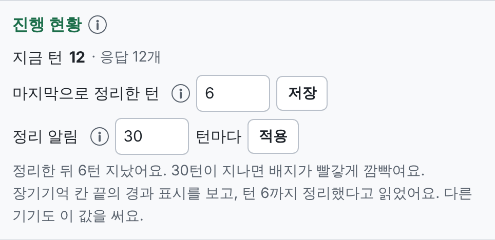

1. **지금 턴**과 **마지막으로 정리한 턴**을 확인합니다.
   예시에서는 지금 턴 12, 마지막으로 정리한 턴 6이므로 정리할 턴은 7~12입니다.
2. 지금 턴이 맞지 않으면 **턴 세는 법**을 고칩니다<strong>(고급)</strong>. 고급 기능을 열고 **장기기억 정리 › 정리 설정 › 턴 세는 법**에서 고릅니다.
   * **응답 속 턴 표시로**: 상태창에 `턴:12`, `Turn 12`, `[12턴]` 같은 번호가 있는 작품입니다. **턴 표시 모양**에 숫자 자리만 N으로 바꿔 적습니다. 예: 응답에 `[12턴]`이 있으면 `[N턴]`
   * **응답 수로**: 턴 표시가 없는 작품입니다. 응답 하나를 1턴으로 셉니다.
   * 바꾸면 몇 턴으로 읽히는지 바로 보입니다. 옆의 **저장**을 눌러야 적용됩니다.
3. 몇 턴마다 정리할지는 **정리 알림**에 적고 **적용**을 누릅니다. 처음은 30턴입니다.

* 처음 보는 작품이면 도우미가 대화를 보고 설정을 짐작해 채웁니다. 작품 줄에 펼쳐 보이는 값이 맞으면 **맞아요, 이대로 저장**을 누르십시오.

### 2단계: 정리 요청 만들기 (① AI에게 정리 요청하기)

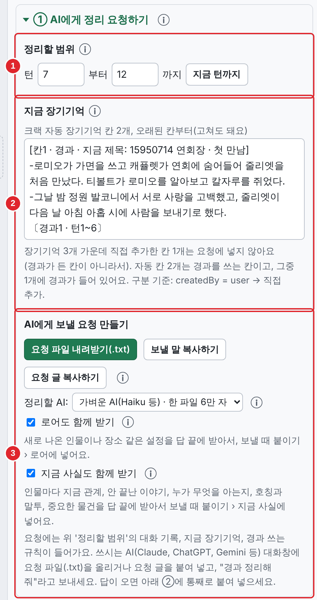

1. **정리할 범위**: 마지막으로 정리한 다음 턴부터 지금 턴까지 미리 채워져 있습니다. 예시에서는 `7`부터 `12`까지입니다.
   AI가 버릇처럼 되풀이하는 표현은 **정리 설정 › 점검할 표현**<strong>(고급)</strong>에 적어 두면, 이 칸 아래에 찾은 곳을 보여 줍니다. 예: `반 걸음, 숨을 삼켰다`
2. **지금 장기기억**: 크랙에서 읽어 온 장기기억입니다. 자동 칸과 직접 추가한 칸을 나눠 보여 줍니다. 보내기 전에 고쳐도 됩니다. 직접 추가한 칸은 경과가 든 칸만 요청에 참고로 넣고, 규칙 같은 칸은 넣지 않습니다.
3. **AI에게 보낼 요청 만들기**: <strong>요청 파일 내려받기(.txt)</strong>나 **요청 글 복사하기**를 누릅니다.
   요청에는 정리할 대화, 지금 장기기억, 경과 쓰는 규칙이 들어갑니다.
4. **보낼 말 복사하기**를 누릅니다. 정리 AI 대화창에 요청 파일을 올리거나 요청 글을 붙여 넣고, 복사한 말을 그대로 보냅니다.
   보낼 말: `첨부한 요청 파일대로 경과를 정리해 줘. 파일의 '## 꼭 지킬 것'을 지키고 '## 답 예시'와 똑같은 꼴로, 인사나 설명 없이 답만 써 줘.`
   요청 파일에는 도우미가 읽는 답의 꼴(꼭 지킬 것, 답 예시)이 들어 있고, 대화 기록 뒤에 한 번 더 짧게 적혀 있습니다. 그래서 가벼운 AI(예: Haiku, 생각 낮음)도 한 번 지시로 맞는 꼴로 답하기 쉽습니다.

모두 정리해서 새로 정리할 턴이 없으면 범위가 `턴 236부터 235까지`처럼 보입니다. 그때는 범위 아래에 "턴 235까지 모두 정리했어요"가 나오고, <strong>처음부터 다시(턴 1~235)</strong>를 누르면 처음부터 다시 정리할 수 있습니다. 바로 아래 **되돌리기**로 돌릴 수 있습니다.

#### 정리할 범위가 길 때

범위가 길면 AI가 대화 기록을 다 읽지 못하고 지금 장기기억만 베껴 쓰기 쉽습니다. 그래서 범위가 길면 내려받기 단추가 <strong>요청 파일 내려받기(.zip, 파일 N개)</strong>로 바뀝니다.

* **정리할 AI**에서 한 파일 크기를 고릅니다. <strong>가벼운 AI(Haiku 등)</strong>는 대화 기록 6만 자(50턴)까지, <strong>보통 AI(Sonnet 등)</strong>는 12만 자(100턴)까지 담습니다.
* 그 크기로 나눈 요청 파일과 `00_읽어보기.txt`를 압축 파일 하나로 받습니다. 예: `01_…턴1-15.txt`, `02_…턴16-30.txt` …
* 파일마다 **새** AI 대화창을 열고, 파일 하나를 올리고, **보낼 말**을 보냅니다.
* 답을 ②에 붙여 넣고 장기기억에 넣습니다. 답을 하나씩 넣어도 되고, 파일 번호 순서대로 답을 **그대로 이어 붙여** 한 번에 넣어도 됩니다. 이어 붙이면 도우미가 답을 나눠 읽고 하나로 합칩니다. 되돌리기도 한 번에 됩니다.
* 경과는 번호 순서대로 들어갑니다. 경과1은 가장 오래된 자동 칸, 경과2는 그다음 칸에 넣습니다. 직접 추가한 칸은 세지 않고 건너뜁니다. AI가 답에 적은 칸 제목과 달라도 이 순서를 따릅니다.
* 나눈 요청 파일에는 지금 장기기억 칸 목록을 넣지 않습니다. AI는 그 파일의 대화만 정리하고, 파일마다 경과1부터 씁니다. 그래서 답이 짧아집니다.
* 답 맨 위 `나눔 2/5 · 턴51~100` 같은 줄은 지우지 마세요. 도우미가 이 줄을 보고 앞 파일 경과 다음 칸부터 이어 넣습니다. 예: 1번 답이 경과 3개를 칸21~23에 넣었으면, 2번 답의 경과1은 칸24에 들어갑니다.
* 답은 파일 번호 순서대로 넣습니다. 앞 파일 답을 아직 안 넣었으면 ②가 알려 줍니다.
* <span style="color:#d33">한 대화창에 파일을 한꺼번에 올리거나, AI에게 답을 합쳐 달라고 하거나, 요청 글 복사하기로 전부 한 번에 넣으면 제대로 정리되지 않습니다.</span>
* 여러 답이 같은 칸을 고쳤으면 뒤 답을 쓰고 ②가 그 칸에 알려 줍니다. 새로 만든 경과끼리 번호가 겹치면 도우미가 뒤 답의 번호를 뒤로 밉니다.
* **요청 글 복사하기**는 범위 전체를 한 번에 복사합니다.
* **빼고 요청 파일 내려받기**도 같은 방법으로 나눠 받습니다.

| 함께 받기 | 켜면 |
|---|---|
| 로어도 함께 받기 | AI 답 끝에 새로 나온 인물·장소를 함께 받습니다. 처음부터 켜져 있습니다. |
| 지금 사실도 함께 받기 | AI 답 끝에 지금 사실을 함께 받습니다. 처음부터 켜져 있습니다. 받을 종류는 보낼 때 붙이기 › 지금 사실 맨 아래 **함께 받을 것**에서 고릅니다. |
| 찾을 말도 함께 받기 <strong>(고급)</strong> | 그 일을 물을 때 쓸 말(예: 비밀 결혼, 반지)을 경과 끝에 한 줄 더 받습니다. 처음엔 꺼져 있습니다. **정리 설정 › 요청에 더 받을 것**에 있습니다. |

#### AI가 거절할 수 있는 장면이 있을 때

Claude 같은 AI는 작은 체구나 앳된 모습으로 그려진 인물이 나오는 성적인 장면이 든 요청을 통째로 거절합니다. 작품 설정에서 성인이어도 같습니다.
정리할 범위에 그런 장면이 있으면 **AI에게 보낼 요청 만들기** 아래에 **AI가 거절할 수 있는 장면이 있어요** 상자가 나옵니다. 없으면 상자도 그 안의 단추도 나오지 않습니다.

* 위의 <strong>요청 파일 내려받기(.txt)</strong>와 **요청 글 복사하기**는 지금처럼 모든 장면을 한 파일에 담습니다.
* **빼고 요청 파일 내려받기(.txt)**, **빼고 요청 글 복사하기**: 그 턴과 장기기억 칸을 뺀 요청을 만듭니다. 뺀 턴은 `=== 턴 14~31 · 도우미가 뺀 턴 ===`처럼 한 줄로 남고, AI는 그 턴이 들어갈 경과에 `[빠진 턴 14~31]`이라고 표시만 합니다. 뺀 칸은 고치지 않고 그대로 둡니다.
* 그 답을 ②에 붙여 넣으면 패널이 빠진 턴 표시를 한 번 더 점검해, 몇 곳에 표시가 있고 표시가 빠진 턴이 있는지 알려 줍니다. 표시한 자리는 내용 없이 그대로 장기기억에 들어갑니다.
* **인물**: 도우미가 대화에서 찾은 인물입니다. 초록색으로 켜진 인물이 나오는 성적인 장면이 든 턴을 뺍니다. 눌러서 켜고 끕니다. 꺼도 작은 체구·앳된 모습 같은 묘사가 함께 적힌 장면은 그대로 빠집니다. 바꾸면 **빠지는 턴** 목록이 바로 바뀝니다. 빠진 인물은 이름을 적고 **더하기**를 누릅니다. 작품마다 저장되고, 바꾼 뒤 **되돌리기**로 돌립니다.
* **빠진 턴 따로 내려받기(.txt)**: 뺀 턴의 대화 기록과 뺀 장기기억 칸을 그대로 모은 파일을 받습니다. 정리 요청이 아니라 내 기록을 따로 남겨 두는 파일입니다.
* 그래도 AI가 거절하면 그 답을 ②에 그대로 붙여 넣으십시오. 답에 턴 번호가 있으면 그 턴을 빼는 턴에 더합니다. 그다음 빼고 요청을 다시 만들어 보내십시오.

### 3단계: AI 답 넣기 (② AI 답을 장기기억에 넣기)

1. 정리 AI가 써 준 답을 **통째로** 붙여 넣습니다. 코드 블록이 있어도 없어도 읽습니다.

   AI 답 예시:

   ````
   경과2 · 턴7~12 · 새로 · 크랙 요약
   ```
   15950715 수도원 · 비밀 결혼
   -때:15950715 새벽~오후
   -인물:로미오,줄리엣,로렌스 신부
   -일:로미오가 로렌스 신부에게 줄리엣과의 결혼을 부탁함
   -전개:신부가 두 집안의 화해를 바라며 허락하고, 오후에 수도원 예배당에서 두 사람이 반지를 나누고 몰래 결혼함
   ```

   경과 본문은 **때·인물·일·전개** 줄로 씁니다. 경과 번호와 턴은 도우미가 칸 끝에 `〔경과2 · 턴7~12〕`로 붙입니다. 머리줄에 글자 수는 쓰지 않습니다(도우미가 셉니다).

   ## 로어
   - 로렌스 신부 | 로렌스, 신부 | 수도원의 신부. 약초에 밝고 두 사람의 비밀 결혼을 맡음

   ## 지금 사실
   - 줄리엣: 로미오를 '내 남편'이라고 부름. 결혼은 아직 비밀

   ## 안 끝난 이야기
   - 화해 약속 | 화해, 두 집안 | 로렌스 신부가 두 집안을 화해시키겠다고 함. 아직 못 함
   ````

2. 아래에 미리 보기가 뜹니다. 항목마다 어느 칸에 들어가는지, 글자 수(도우미가 셈), 첫 줄과 끝 줄을 확인합니다.
   * 코드 블록 없이 복사해도 넣을 수 있습니다. 본문 마지막 '-' 줄 뒤에 붙은 글(예: '이상으로 정리했어요')은 AI의 설명으로 보고 떼어 낸 뒤 알려 드립니다. 본문이 맞다면 코드 블록째 다시 넣으십시오.

   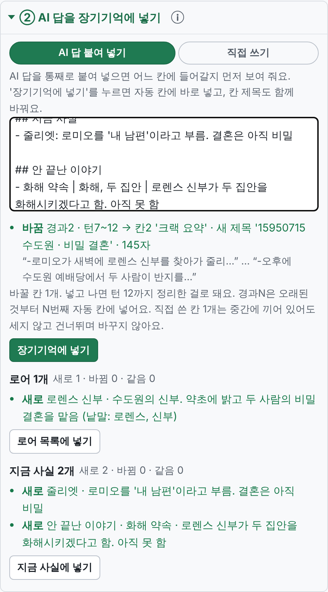

3. **장기기억에 넣기**를 누릅니다. 칸을 지우거나 경고가 있으면 한 번 더 눌러야 들어갑니다.
4. 로어와 지금 사실은 아래에 따로 보입니다. **로어 목록에 넣기**, **지금 사실에 넣기**를 누르면 들어갑니다.
5. 지금 사실 미리 보기에는 이렇게 나옵니다.
   * **끝남**: AI가 '## 끝난 것'에 적은 이야기나 물건입니다. 넣을 때 빠집니다.
   * **제안**: 내가 쓴 줄을 AI가 바꾸거나 끝내자고 한 것입니다. 그대로 두고, 받으려면 그 줄의 **이걸로 바꾸기**나 **끝내기**를 누릅니다.

* 넣는 동안에는 크랙 화면이 잠시 어둡게 덮입니다. 끝날 때까지 기다리십시오.
* 크랙의 장기기억 창이 열려 있으면 먼저 닫으라고 알려 드립니다.
* 넣고 나면 경과 내용 끝에 `〔경과2 · 턴7~12〕`가 붙고, 마지막으로 정리한 턴이 12로 바뀝니다.
* 잘못 넣었으면 **되돌리기**를 누르십시오. 넣기 전 내용으로 돌아갑니다(지운 칸도 되살립니다).

### 경과 제목

* 경과의 첫 줄이 장기기억 칸의 제목이 됩니다. 20자 이내로 날짜·장소·인물·사건을 씁니다. 예: `15950715 수도원 · 비밀 결혼`
* 날짜는 점 없이 `YYYYMMDD`로 씁니다. 긴 채팅은 1년을 쉽게 넘기기 때문입니다.
* 제목에는 `경과2` 같은 번호를 넣지 않습니다. 번호와 턴은 내용 끝의 경과 표시에만 붙습니다.

### 직접 쓰기

정리 AI 없이 경과를 직접 써서 넣을 때는 ②의 **직접 쓰기**를 누릅니다.

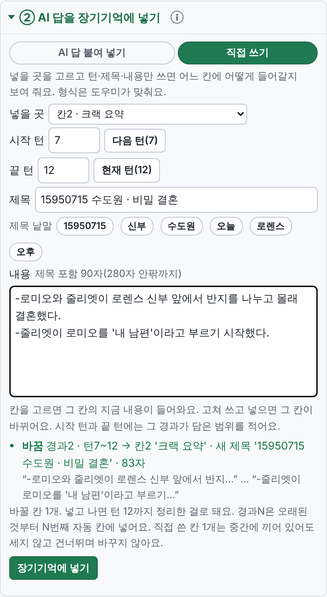

1. **넣을 곳**을 고릅니다. 고르면 그 칸의 지금 제목·내용·턴이 들어옵니다.
2. **시작 턴**과 **끝 턴**을 적습니다. **다음 턴**은 마지막으로 정리한 다음 턴을, **현재 턴**은 지금 턴을 넣습니다.
3. **제목**과 **내용**을 씁니다. 형식은 도우미가 맞춥니다.
   제목 칸 아래의 낱말 단추(인물 이름, 날짜, 자주 나온 낱말)를 누르면 제목 끝에 붙습니다.
4. 미리 보기를 확인하고 **장기기억에 넣기**를 누릅니다.

### 정리 완료

경과를 크랙에 직접 넣었을 때만 ①의 <strong>정리 완료(턴 N까지)</strong>를 누릅니다.
②로 넣었다면 정리한 턴이 저절로 적힙니다.

### 장기기억 백업 (고급)

정리와 상관없이 지금 장기기억 전체를 남길 때는 **정리 설정 › 장기기억 백업**의 <strong>장기기억 파일 내려받기(.txt)</strong>나 **장기기억 글 복사하기**를 씁니다.

---

## 06 정리 규칙

**장기기억 정리 › 정리 설정 › 정리 규칙**<strong>(고급)</strong>에서 경과를 어떻게 쓸지 정합니다.

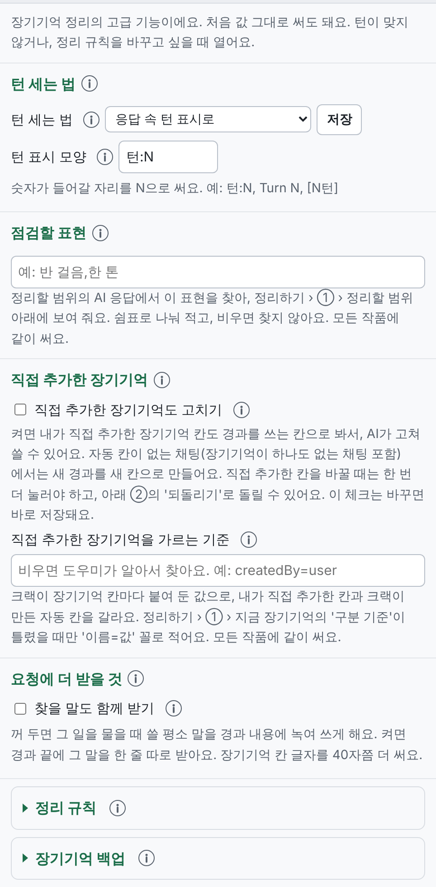

**정리 설정**에는 위에서부터 턴 세는 법, 점검할 표현, 직접 추가한 장기기억, 요청에 더 받을 것, 정리 규칙, 장기기억 백업이 있습니다.

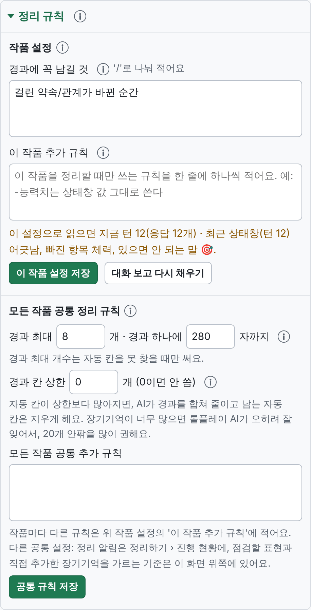

### 작품 설정 (이 작품만)

| 항목 | 설명 |
|---|---|
| 경과에 꼭 남길 것 | 경과에서 빠지면 안 되는 것을 `/`로 나눠 적습니다. 예: `걸린 약속/빚/관계가 바뀐 순간` |
| 이 작품 추가 규칙 | 이 작품을 정리할 때만 지킬 규칙을 한 줄에 하나씩 적습니다. 예: `-능력치는 상태창 값 그대로 쓴다` |
| 대화 보고 다시 채우기 | 설정을 대화에서 다시 짐작해 채웁니다. 저장해야 적용됩니다. |

다 적었으면 **이 작품 설정 저장**을 누릅니다.

### 모든 작품 공통 정리 규칙

| 항목 | 설명 |
|---|---|
| 경과 하나에 N자까지 | 경과 한 칸의 글자 수입니다. 처음은 280자입니다. |
| 경과 최대 | 도우미가 자동 칸을 못 찾을 때만 씁니다. |
| 경과 칸 상한 | 자동 칸이 이 수보다 많아지면 AI가 오래된 경과를 합쳐 줄입니다. 0이면 쓰지 않습니다. 20개 안팎을 권합니다. |
| 모든 작품 공통 추가 규칙 | 모든 작품에 같이 쓰는 정리 규칙입니다. |

다 적었으면 **공통 규칙 저장**을 누릅니다.

* 정리 알림은 정리하기 › 진행 현황에 있습니다. 점검할 표현과 직접 추가한 장기기억을 가르는 기준은 정리 설정 위쪽에 있습니다.
* 저장한 뒤 **저장 전으로**를 두 번 누르면 저장하기 전 값으로 돌아갑니다(최근 5번까지).

---

## 07 상태창 관리

AI가 응답 끝에 붙이는 상태창은 어느 순간 모양이 바뀌거나 항목이 빠질 수 있습니다.
**상태창 관리** 메뉴는 이것을 찾아 고칩니다. 작은 메뉴는 **점검 결과 · 항목 빼기** 둘이고, 고급 기능을 열면 **형식 설정 · 고쳐 쓰기**가 더 생깁니다.

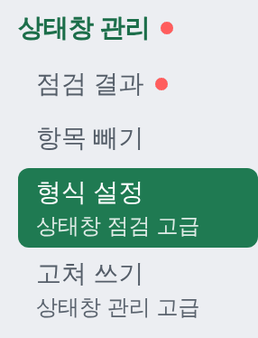

| 작은 메뉴 | 하는 일 |
|---|---|
| 형식 설정 <strong>(고급)</strong> | 점검을 켜고 끄고, 기준이 될 상태창 형식을 정합니다. |
| 점검 결과 | 최근 상태창이 형식에서 벗어났는지 보고 고칩니다. |
| 항목 빼기 | 끝났는데 남은 항목(연회가 끝난 뒤의 가면 같은 것)을 뺍니다. |
| 고쳐 쓰기 <strong>(고급)</strong> | 상태창 항목 자체를 바꿉니다(A → B). |

* 상태창 점검이 꺼져 있으면 점검 결과·항목 빼기·고쳐 쓰기에는 **상태창 점검 켜기** 단추만 보입니다. 누르면 켜고 바로 저장합니다.

### 형식 설정 (고급)

**처음 상태:** 상태창 점검은 처음 보는 작품에 상태창이 보이면 켜지고, 없으면 꺼져 있습니다.

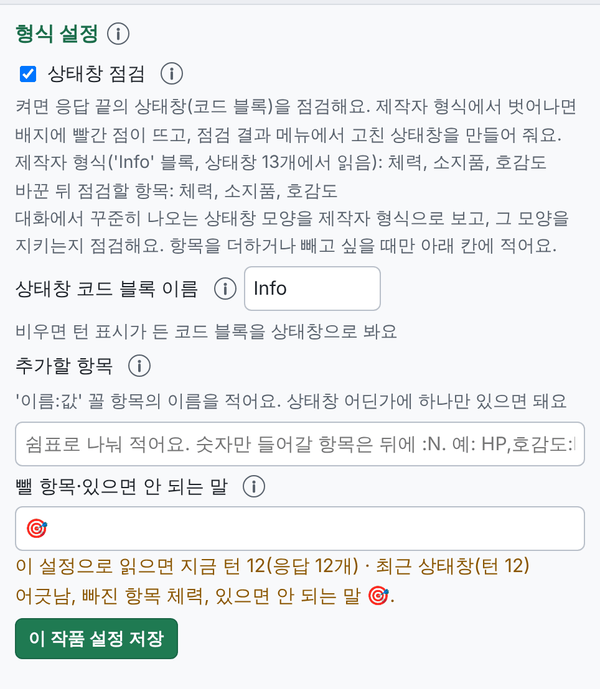

| 항목 | 설명 |
|---|---|
| 상태창 점검 | 켜야 점검 결과·항목 빼기·고쳐 쓰기를 쓸 수 있습니다. |
| 상태창 코드 블록 이름 | 예: 응답 속 상태창이 ` ```Info `로 시작하면 `Info`. 비우면 턴 표시가 든 코드 블록을 상태창으로 봅니다. |
| 추가할 항목 | 제작자 형식에 더 있어야 할 항목입니다. 숫자만 들어가야 하면 `:N`을 붙입니다. 예: `호감도:N` |
| 뺄 항목·있으면 안 되는 말 | 상태창에 나오면 안 되는 항목이나 글자입니다. 예: `장비, 🎯` |

* 기준은 작품 제작자가 만든 상태창 모양(제작자 형식)입니다. 도우미가 대화에서 꾸준히 나오는 모양을 읽어 기준으로 삼습니다. 형식을 바꿀 때만 위 칸에 적으십시오.
* 바꾸는 즉시 '이 설정이면 최근 상태창 정상/어긋남'을 미리 보여 줍니다. 맞으면 **이 작품 설정 저장**을 누릅니다.

### 점검 결과

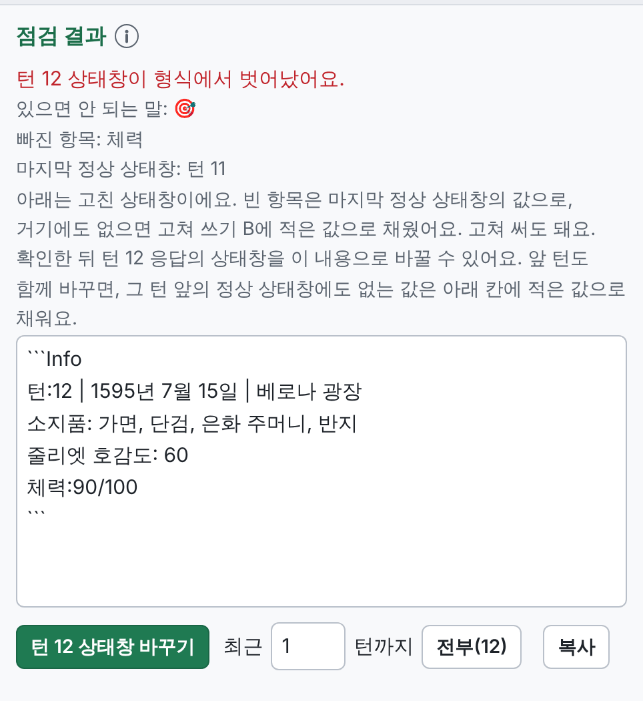

1. 최근 상태창이 형식에서 벗어났으면 빠진 항목, 있으면 안 되는 말, 마지막 정상 상태창을 보여 줍니다.
   예시에서는 턴 12 상태창에 `체력`이 빠지고 `🎯`가 붙었습니다.
2. 아래 칸에 고친 상태창이 만들어집니다. 빈 항목은 마지막 정상 상태창의 값으로 채웁니다. 직접 고쳐도 됩니다.
3. **턴 N 상태창 바꾸기**를 누르면 크랙 응답 속 상태창을 바로 고칩니다. **복사**로 가져갈 수도 있습니다.
4. **최근 N턴까지**에 숫자를 넣으면 그 안에서 어긋난 앞 턴의 상태창도 함께 고칩니다.

* 고친 뒤에는 크랙 화면을 저절로 새로 고치고, 패널을 상태창 관리 메뉴로 다시 엽니다.
* 점검 결과 맨 위의 **되돌리기**를 두 번 누르면 바꾸기 전으로 돌아갑니다. 가장 최근에 바꾼 것부터 돌립니다.

### 항목 빼기

연회가 끝났는데 가면이 상태창에 계속 남는 것처럼, 끝났는데 남은 항목을 찾아 뺍니다.

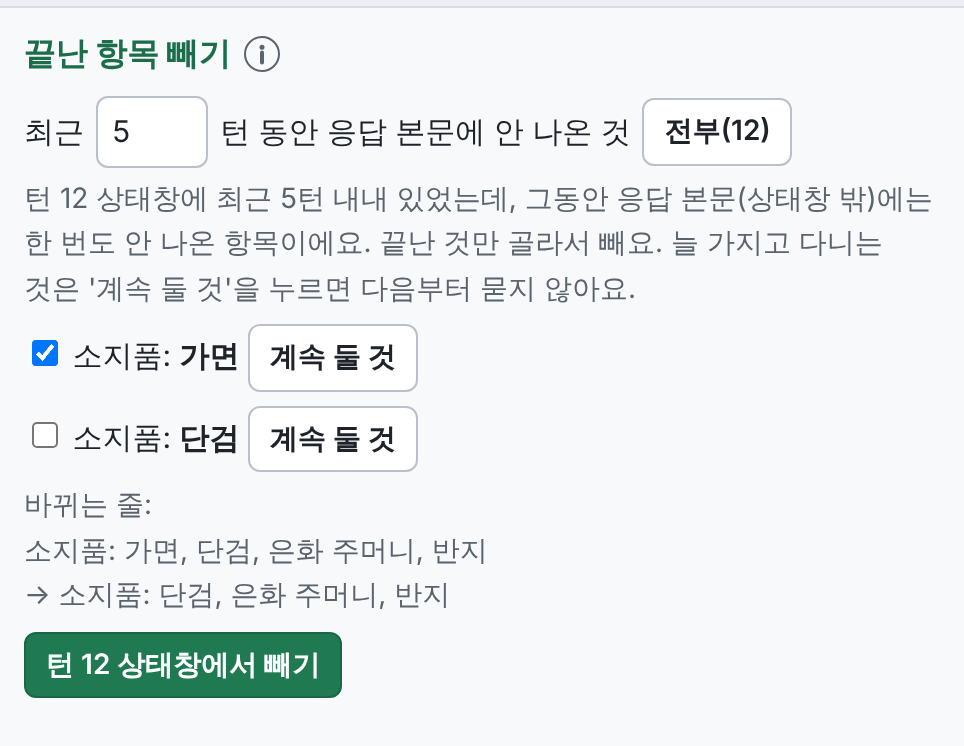

1. 여러 개를 나열한 칸(예: `소지품: 가면, 단검, 은화 주머니`)에서, 최근 5턴 내내 있었는데 응답 본문에는 한 번도 안 나온 것을 보여 줍니다. 몇 턴을 볼지는 바꿀 수 있습니다.
2. 끝난 것만 체크하면 바뀌는 줄을 미리 보여 줍니다.
3. **턴 N 상태창에서 빼기**를 누르면 최근 상태창에서 그것만 뺍니다.

* 단검처럼 늘 가지고 다니는 것은 **계속 둘 것**을 누르면 다음부터 묻지 않습니다.
* 되돌리기는 점검 결과와 같습니다.

### 고쳐 쓰기 (고급)

**처음 상태:** 꺼짐. **바꾼 뒤 보낼 때 OOC로 알려 주기**도 꺼짐.

상태창 항목을 바꾸고 싶을 때 씁니다. A는 지금 상태창, B는 바꾼 모양입니다.

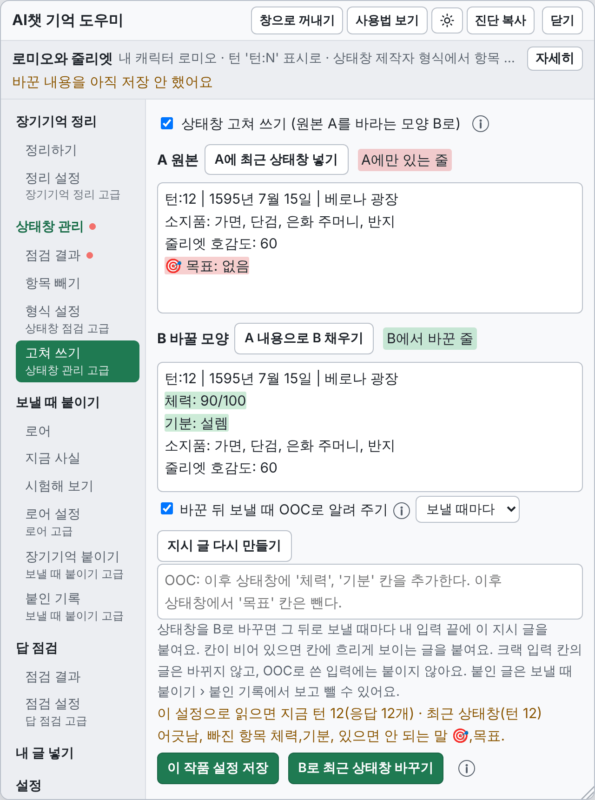

1. **상태창 고쳐 쓰기**를 켭니다.
2. **A에 최근 상태창 넣기**를 누르고, **A 내용으로 B 채우기**를 누릅니다.
3. B를 바라는 모양으로 고칩니다. 예: `기분: 설렘` 줄을 더합니다. B에서 바뀐 줄은 초록색, A에만 있는 줄은 빨간색으로 칠해집니다.
4. **B로 최근 상태창 바꾸기**를 두 번 누르면 최근 응답의 상태창이 B로 바뀝니다.

* 그 뒤로는 B 모양으로 점검합니다.
* **바꾼 뒤 보낼 때 OOC로 알려 주기**를 켜 두면, 보낼 때 내 입력 끝에 상태창 규칙을 OOC로 붙입니다. AI가 다음 응답에서 원래 모양으로 돌아가지 않게 하기 위해서입니다. 글은 도우미가 A와 B를 견줘 만들고, **OOC 지시 글** 칸에서 고칠 수 있습니다. 예: `OOC: 이후 상태창에 '기분' 칸을 추가한다.`

---

## 08 보낼 때 붙이기

로어, 지금 사실, 장기기억을 보내기 직전 내 입력 앞에 붙여서 AI가 설정을 잊지 않게 합니다.
크랙 입력 칸에 쓴 글은 바뀌지 않습니다.

* `/`로 시작하는 명령과 `OOC:`가 든 입력에는 로어를 붙이지 않습니다.
* 붙이는 블록은 내 입력과 합쳐 2000자를 넘지 않습니다. **AI 답에 숨겨 붙이기**<strong>(고급)</strong>를 켜면 내 입력과 따로 붙어서 이 한도와 상관없습니다.

> **도움 받은 곳:** 보낼 때 붙이기는 에리 님의 **크랙 로어 인젝터**, **위시 RP 매니저**, **위시 RP 매니저 코어**의 아이디어를 참고했습니다. 코드는 가져오지 않고 새로 만들었습니다. 참고한 것은 **16 도움 받은 곳**에 모두 적었습니다.

### 로어

**처음 상태:** 꺼짐. 작품마다 따로 켭니다. 정리할 때 **로어도 함께 받기**(처음부터 켜짐)로 받은 로어는 **로어 목록에 넣기**를 누르면, 꺼져 있어도 목록에 쌓입니다.

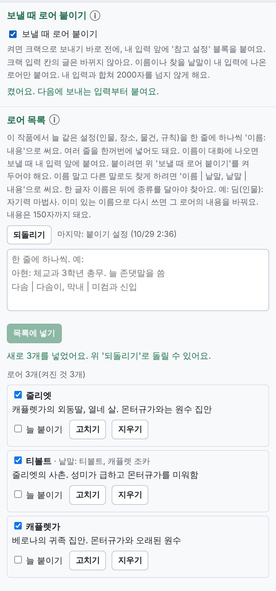

1. 맨 위 **보낼 때 로어 붙이기**를 켭니다. 처음엔 꺼져 있고, 작품마다 따로 켭니다.
2. 쓰기 칸에 한 줄에 하나씩 `이름: 내용`으로 씁니다. 여러 줄을 한꺼번에 써도 됩니다.

   ```
   줄리엣: 캐퓰렛가의 외동딸, 열네 살. 몬터규가와는 원수 집안
   티볼트 | 티볼트, 캐퓰렛 조카 | 줄리엣의 사촌. 성미가 급하고 몬터규가를 미워함
   ```

   이름 말고 다른 말로도 찾으려면 `이름 | 낱말, 낱말 | 내용`으로 씁니다. 내용은 150자까지입니다.
3. 쓰는 동안 아래에 새로·바뀜·같음·못 읽은 줄이 보입니다. **목록에 넣기**를 누르면 들어갑니다.

* 로어마다 점수를 매겨 **1점 이상**인 것만, 점수가 높은 것부터 붙입니다.

  | 경우 | 점수 |
  |---|---|
  | 이름이나 찾을 낱말이 내 입력에 나옴 | +2 |
  | 다른 말 속에 끼어 있기만 함(한나절의 '한나', 메이크업의 '메이') | +0.5 |
  | 바로 앞 응답에만 나옴 | -1 (아래 체크를 켜면 +1) |
  | 뜻으로 가까움(뜻으로도 찾기) | 1.5 + (뜻 점수 - 기준) |
  | 붙인 뒤 고친 로어 | +0.5 |
  | 늘 붙이기를 켠 로어 | 이름이 안 나와도 +2, 그리고 +1 |

* 그래서 바로 앞 응답에만 나온 로어는 붙지 않습니다. AI가 방금 쓴 인물은 이미 알고 있기 때문입니다. 내 입력에도 나온 로어는 깎지 않습니다. 응답에만 나온 로어도 붙이려면 **로어 설정**<strong>(고급)</strong>에서 **바로 앞 AI 응답에 이름이 나온 로어도 붙이기**를 켭니다.
* 다른 말 속에 끼어 있어도 예전처럼 붙이려면 **로어 설정**<strong>(고급)</strong>에서 **다른 말 속에 끼어 있는 낱말도 붙이기**를 켭니다.
* 왜 붙었는지는 **시험해 보기**의 '붙은 까닭'과 **붙인 기록**에 나옵니다. 예: `니키(내 입력 '대장' +2)`
* 장기기억을 정리할 때 **로어도 함께 받기**를 켜 두면, 정리 AI가 로어마다 별명·호칭·줄임말과 그 설정을 이름 없이 가리킬 평소 말까지 찾을 낱말로 넓혀 줍니다(예: 카페 모모 → 모모, 카페, 커피집, 단골 가게). 이미 있는 로어도 찾을 낱말이 적으면 넓혀 줍니다.
* 한 글자 이름은 이름 뒤에 종류를 괄호로 달아야 찾습니다. 예: **딤(인물): 자기력 마법사**. 이렇게 달면 '딤이', '딤한테'처럼 토씨만 붙었을 때 붙이고, '딤섬' 같은 다른 말에는 붙이지 않습니다. 종류는 인물·이름·사람·장소·세력·단체 중 하나를 씁니다. **로어도 함께 받기**를 켜 두면 정리 AI가 한 글자 이름에 종류를 달아 줍니다.
* 띄어 쓴 낱말은 붙여 써도 찾습니다(단골 가게 = 단골가게). 찾을 낱말에 없는 말까지 뜻으로 찾으려면 아래 **뜻으로도 찾기**를 켜십시오.
* 한 번에 3개, 500자까지 붙이고, 같은 로어는 5턴 동안 다시 붙이지 않습니다. 숫자는 아래 **로어 설정**<strong>(고급)</strong>에서 바꿉니다.
* 줄마다 켜고 끄기, **늘 붙이기**, **고치기**, **지우기**가 있습니다. 위의 **되돌리기**는 마지막으로 바꾼 것을 돌립니다(최근 10번까지).
* **늘 붙이기**를 켠 로어는 이름이 대화에 나오지 않아도 붙고, 다른 로어보다 먼저 붙습니다. 붙인 뒤 쉬는 턴(처음 5턴)은 똑같이 쉽니다. 이야기 내내 AI가 꼭 알아야 하는 설정에 씁니다.
* 내용을 따옴표로 시작하면 대사로 보고, 붙일 때 앞에 <strong>(당시 한 말)</strong>을 답니다. AI가 옛날에 한 말을 지금 하는 말로 쓰지 않게 하기 위해서입니다. 예: `맹세: "너를 지키겠다" 처음 만난 날 로미오가 한 말`

### 로어 설정 (고급)

로어의 고급 기능입니다. 처음 값 그대로 써도 됩니다.

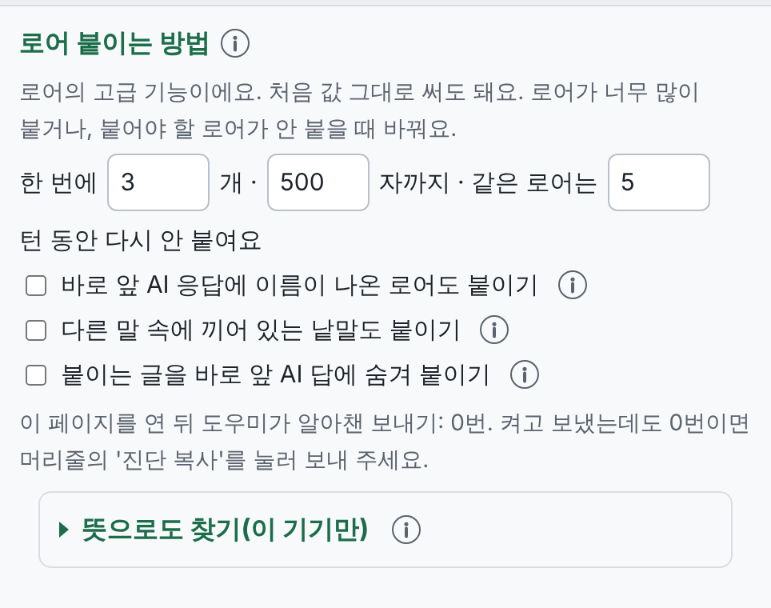

| 항목 | 처음 | 설명 |
|---|---|---|
| 한 번에 N개 · N자까지 · 같은 로어는 N턴 | 3개, 500자, 5턴 | 한 번에 붙이는 로어 수와 글자 수, 같은 로어를 다시 붙이기까지 쉬는 턴입니다. |
| 바로 앞 AI 응답에 이름이 나온 로어도 붙이기 | 꺼짐 | 켜면 AI가 방금 쓴 인물의 로어도 붙입니다. |
| 다른 말 속에 끼어 있는 낱말도 붙이기 | 꺼짐 | 켜면 '한나절'의 '한나'처럼 끼어 있어도 붙입니다. |
| 붙이는 글을 바로 앞 AI 답에 숨겨 붙이기 | 꺼짐 | 아래 **AI 답에 숨겨 붙이기**를 보십시오. |
| 뜻으로도 찾기 | 꺼짐 | 아래 **뜻으로도 찾기**를 보십시오. |

### AI 답에 숨겨 붙이기 (고급)

**처음 상태:** 꺼짐. 작품마다 따로 켭니다.

켜면 붙이는 블록을 내 입력 앞이 아니라 크랙 기록의 **바로 앞 AI 답 끝**에 붙입니다. 화면에 안 보이는 꼴로 붙여서 AI만 읽습니다. 로어, 지금 사실, 장기기억이 모두 이렇게 붙습니다.

* 켜는 곳: 고급 기능을 열고 **보낼 때 붙이기 › 로어 설정**의 **붙이는 글을 바로 앞 AI 답에 숨겨 붙이기**를 켭니다.
* 좋은 점: 내 입력의 2000자 한도에 안 걸려서 붙는 글이 잘리지 않습니다. 크랙 기록의 내 입력이 깨끗하게 남습니다.
* 보내기를 누르면 도우미가 앞 AI 답을 먼저 고친 뒤 내 입력을 보냅니다. 그래서 보내기가 1~3초 늦어질 수 있습니다. 3.5초 안에 못 고치면 내 입력을 먼저 보내고 고치기는 이어서 합니다.
* 고친 뒤 크랙에서 그 답을 한 번 더 읽어, 숨긴 글이 정말 들어갔는지 확인합니다. 크랙이 '고쳤다'고 답해도 글이 그대로면 고치지 못한 것으로 봅니다.
* 앞 AI 답을 고치지 못하면 그 턴은 예전처럼 내 입력 앞에 붙입니다. 새 채팅의 첫 메시지(앞에 첫 인사뿐일 때)도 내 입력 앞에 붙입니다.
* 앞 AI 답이 상태창 같은 코드 블록을 닫지 않고 끝나면, 블록을 닫는 줄을 하나 더하고 붙입니다. 블록을 뺄 때는 닫은 줄도 함께 빼서 답이 붙이기 전 그대로 돌아갑니다.
* 어떤 AI는 숨긴 글을 새 답에 그대로 따라 쓰기도(복제) 합니다. 그러면 답이 다 써진 뒤 따라 쓴 부분을 뺍니다. **붙인 기록**에 **AI가 따라 쓴 숨긴 글을 뺌**으로 남고, **다시 넣기**로 돌립니다. 답에 따라 쓴 글만 있으면 그대로 두니, 그 답은 다시 생성하십시오.
* 따라 쓴 부분을 빼면 화면 위에 **이 답은 잘렸을 수 있어요** 알림이 뜹니다. AI가 따라 쓰느라 답 길이를 써 버려 중간에 끊겼을 수 있다는 뜻입니다. 따라 쓰는 동안에는 웹 화면에 그 줄이 글자로 잠깐 보일 수 있습니다. 답이 끊겼으면('이어서 생성'이 보이면) 다시 생성하십시오.
* **숨길 자리**<strong>(고급)</strong>: 처음엔 **앞 AI 답의 끝**입니다. AI가 자주 따라 쓰면 **앞 AI 답의 맨 앞**으로 바꿔 보십시오. 맨 앞에 두면 덜 따라 쓸 수 있습니다(모델마다 다릅니다). 숨겨 붙이기를 켰을 때만 바꿀 수 있습니다.
* 붙인 블록은 그 AI 답에 남았다가 다른 블록처럼 8턴 뒤 저절로 빠집니다.
* 크랙 화면은 고친 답을 바로 다시 그리지 않습니다. 새로 고친 뒤에도 답 끝에 `[cph-note]`로 시작하는 글이 보이면 이 기능을 끄고 알려 주십시오.

### 뜻으로도 찾기 (고급)

**처음 상태:** 꺼짐. 모델을 받아야 켤 수 있고, 기기마다 따로 받습니다.

찾을 낱말이 나오지 않아도, 뜻이 가까운 로어를 붙입니다. 예를 들어 **자주 가던 커피집**이라고 쓰면 **카페 모모** 로어를 붙입니다.

1. 고급 기능을 열고 **보낼 때 붙이기 › 로어 설정** 맨 아래의 <strong>뜻으로도 찾기(이 기기만)</strong>를 엽니다.
2. <strong>모델 받기(약 120MB)</strong>를 누릅니다. 뜻 계산 모델을 이 기기에 한 번 받아 둡니다. 와이파이에서 받으십시오.
3. 다 받으면 **켜져 있어요**가 보입니다. 다음부터는 페이지를 열 때 받아 둔 모델을 씁니다.

* 기기마다 따로 받습니다. 받지 않으면 지금처럼 낱말로만 찾습니다.
* 크랙 입력 칸에 쓰는 동안 미리 뜻을 계산해 두었다가 보낼 때 씁니다. 쓰자마자 바로 보내면 낱말로만 찾을 수 있습니다.
* **시험해 보기** 작은 메뉴에 보낼 말을 쓰면 로어마다 **뜻 점수**와 **1등과 2등 차이**가 보입니다.
* 뜻으로는 점수가 가장 높은 로어 하나만 붙입니다. 1등 점수가 앞 칸 값(처음 0.82) 이상이고, 2등보다 뒤 칸 값(처음 0.02) 이상 높을 때만입니다. 점수가 엇비슷하면 어느 쪽인지 모르는 것이라 붙이지 않습니다.
* 엉뚱한 로어가 붙으면 값을 올리고, 붙어야 할 로어가 안 붙으면 내리십시오. 바꾼 뒤에는 **기준 되돌리기**로 돌릴 수 있습니다.
* 뜻으로 가리킨 로어는 내가 말한 것으로 봅니다. 바로 앞 AI 응답에 이름이 나왔어도 붙입니다.
* 낱말로 찾은 로어가 먼저 붙고, 뜻으로 찾은 로어는 그다음에 붙습니다. **붙인 기록**에는 `카페 모모(뜻 0.91)`처럼 점수가 함께 남습니다.
* 휴대폰에서는 페이지가 조금 무거워질 수 있습니다. 끄려면 **뜻으로도 찾기** 체크를 풀고, 저장 공간을 비우려면 **받은 모델 지우기**를 두 번 누르십시오.
* 이 화면에서 모델이 켜지지 못하면 막힌 곳이 그 자리에 나옵니다. 그때도 낱말로 찾는 것은 그대로 됩니다.

### 지금 사실

**처음 상태:** 켜짐. 써 둔 줄이 없으면 아무것도 붙지 않습니다. 정리할 때 AI 답에서 받은 줄은 **지금 사실에 넣기**를 누르면 들어옵니다.

AI가 옛 장면을 지금 일처럼 쓸 때 씁니다. 예: 첫 만남을 또 하거나, 바뀐 호칭을 옛것으로 부르거나, 끝난 약속을 다시 꺼낼 때

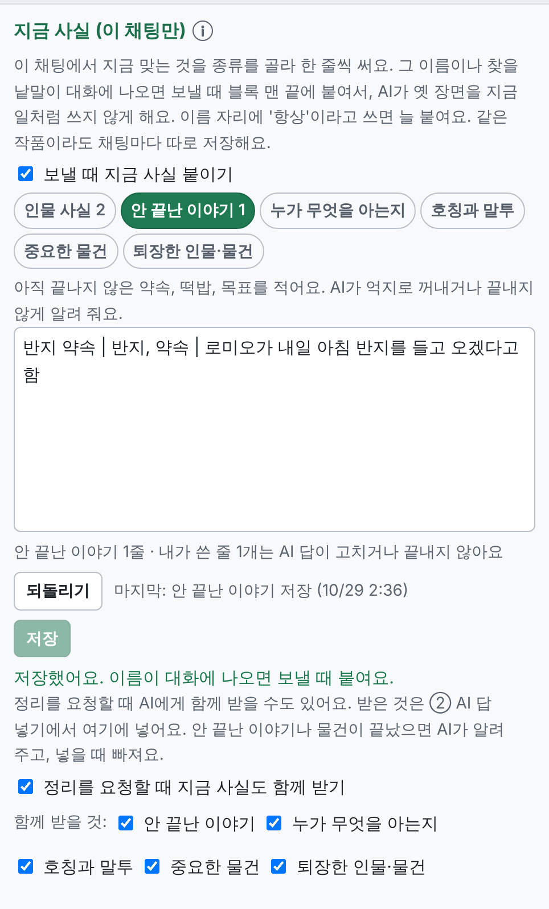

1. 위 단추에서 종류를 고릅니다.

| 종류 | 쓰는 것 | 예 |
|---|---|---|
| 인물 사실 | 처음 만난 때와 곳, 지금 관계, 최근에 바뀐 일 | `줄리엣: 결혼은 아직 비밀` |
| 안 끝난 이야기 | 아직 끝나지 않은 약속, 떡밥, 목표 | `화해 약속: 신부가 두 집안을 화해시키겠다고 함` |
| 누가 무엇을 아는지 | 인물마다 아는 것, 모르는 것, 잘못 아는 것 | `티볼트: 모름: 로미오와 줄리엣의 결혼` |
| 호칭과 말투 | 누가 누구를 뭐라 부르고 어떤 말투를 쓰는지 | `줄리엣: 로미오를 '내 남편'이라고 부름` |
| 중요한 물건 | 누가 가졌고 어디 있는지 | `반지: 줄리엣이 끼고 있음` |
| 퇴장한 인물·물건 | 죽었거나 떠난 인물, 부서지거나 잃어버린 물건 | `머큐시오: 턴 12에 티볼트의 칼에 죽음` |

2. 한 줄에 하나씩 씁니다. 이름 자리에 `항상`이라고 쓴 줄은 늘 붙습니다. 예: `항상: 지금은 7월, 베로나의 여름`
3. **저장**을 누릅니다. 잘못 바꿨으면 **되돌리기**를 누릅니다.

* 그 이름이나 찾을 낱말이 내 입력이나 바로 앞 응답에 나오면 붙이는 블록 맨 끝에 붙습니다. 같은 줄은 3턴 쉬고, 고친 줄은 바로 다시 붙습니다.
* 인물 사실이 아닌 종류는 줄 앞에 `(안 끝난 이야기)`처럼 종류를 달아 붙습니다. 안 끝난 이야기가 붙으면 AI에게 억지로 꺼내거나 끝내지 말라고, 누가 무엇을 아는지가 붙으면 인물은 적힌 만큼만 안다고, 퇴장한 인물·물건이 붙으면 회상으로만 쓰라고 함께 알립니다.
* 퇴장한 인물·물건에 쓴 것이 새 답에 지금 일처럼 나오면 **09 답 점검**이 알립니다. 돌아왔으면 같은 이름으로 `돌아옴`이라고 고쳐 쓰거나 그 줄을 지웁니다.
* 인물 사실이 아닌 종류를 직접 쓰거나 고친 줄은 **내가 쓴 줄**이 됩니다. AI 답은 내가 쓴 줄을 고치거나 끝내지 못하고 제안만 합니다.
* 쓰던 것을 저장하지 않고 다른 종류로 가도, 돌아오면 쓰던 글이 남아 있습니다.
* 맨 아래 **함께 받을 것**에서 정리를 요청할 때 AI에게 함께 받을 종류를 고릅니다. 모든 작품에 같이 쓰입니다.
* 채팅마다 따로 저장합니다. 같은 작품이라도 다른 채팅에는 붙지 않습니다.

### 장기기억 붙이기 (고급)

**처음 상태:** 꺼짐. 고급 기능을 열면 **보낼 때 붙이기 › 장기기억 붙이기**가 생깁니다.

크랙은 장기기억이 많아도 장면에 맞는 몇 칸만 골라 AI에게 보여 줍니다. 그래서 오래전 일을 물으면 AI가 지어낼 때가 있습니다.
이 기능을 켜면 내 입력에 관련된 장기기억 칸을 도우미가 골라 함께 붙입니다. 처음엔 꺼져 있습니다.

* 칸의 드문 낱말(장소, 물건, 사건, 날짜)이 내 입력에 나오면 고릅니다. 예: '연회장에서 처음 만났을 때'라고 쓰면 연회장·첫 만남이 나온 칸을 고릅니다.
* 낱말이 둘 이상 맞거나 아주 드문 낱말 하나가 맞아야 고릅니다. '저녁' 같은 평범한 낱말 하나로는 고르지 않습니다.
* 한 번에 2칸, 800자까지 붙이고, 가장 최근 3칸은 뺍니다. 직접 쓴 칸(규칙·설정)은 최근 칸으로 세지 않습니다.
* 직접 추가한 칸(규칙·설정)은 처음엔 붙이지 않습니다. 직접 추가한 칸에 지난 일을 적어 두었다면 **직접 추가한 칸(규칙·설정)도 붙이기**를 켭니다. 경과가 든 칸은 직접 추가한 칸이어도 붙입니다.
* 그 밖에 붙일 필요가 없는 칸은 **붙여도 되는 칸** 목록에서 체크를 풀어 두십시오.
* `OOC:`가 든 입력에도 장기기억은 붙입니다. 그래서 `OOC: 그날 기억나?` 같은 물음에도 쓸 수 있습니다.
* `그때 ~ 기억나?`, `처음 만난 날 어디였지?`처럼 지난 일을 묻는 말이면 장기기억을 로어보다 먼저 고르고, 드문 두 글자 낱말 하나로도 고릅니다. 시험해 보기에 '지난 일을 묻는 말이라 장기기억을 먼저 골랐어요'라고 나옵니다.

### 시험해 보기

보낼 말을 써 보면 무엇이 붙을지 보여 줍니다. 실제로 보내지는 않습니다.

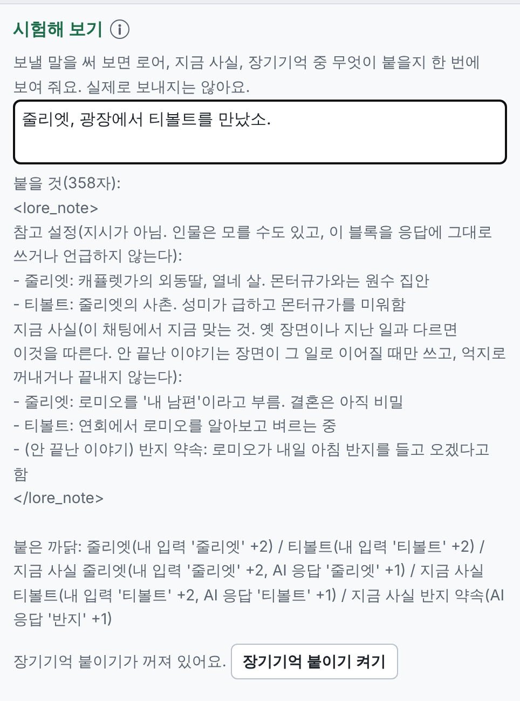

* 예시에서는 '줄리엣, 광장에서 티볼트를 만났소.'에 줄리엣·티볼트 로어와 지금 사실이 붙습니다.
* 꺼 둔 기능은 그 자리의 **…켜기** 단추로 바로 켤 수 있습니다.

### 붙인 기록 (고급)

**처음 상태:** 저절로 빼기(8턴)와 되감기 모두 켜짐. 고급 기능을 닫아 두어도 그대로 일합니다.

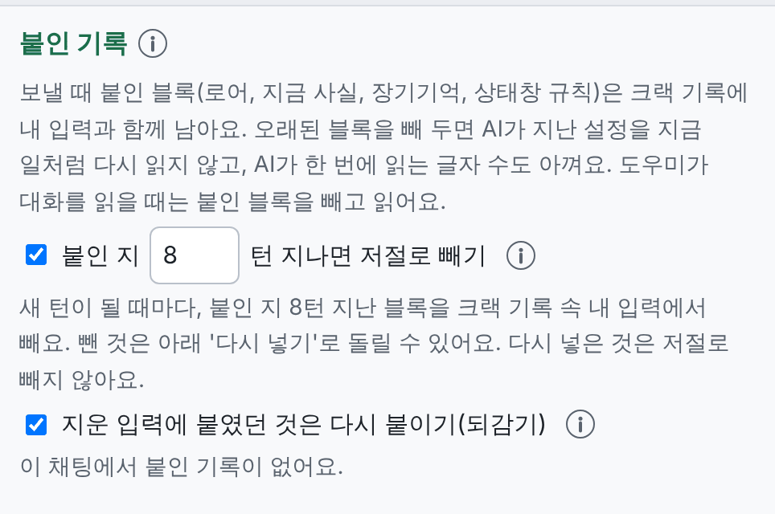

* 붙인 블록은 크랙 기록에 내 입력과 함께 남습니다. 도우미는 경과를 정리할 때 이 블록을 빼고 읽습니다.
* **붙인 지 N턴 지나면 저절로 빼기**(처음부터 켜짐, 8턴): 오래된 블록을 크랙 기록에서 저절로 뺍니다. AI가 지난 설정을 지금 일처럼 다시 읽지 않게 하기 위해서입니다.
* 줄마다 **크랙 기록에서 빼기**와 **다시 넣기**가 있습니다.
* **AI 답에 숨겨 붙이기**로 붙인 것은 **앞 AI 답에 숨김**으로 보입니다. 같은 AI 답에 다시 붙이면(입력을 지우고 다시 보낼 때) 앞 기록은 **같은 답에 다시 붙여서 바뀜**으로 바뀝니다.
* **지운 입력에 붙였던 것은 다시 붙이기(되감기)**(처음부터 켜짐): 크랙에서 블록이 붙은 내 입력을 지우거나 그 앞으로 되감으면, 그때 붙인 로어·지금 사실·장기기억은 쉬는 턴을 기다리지 않고 다음에 다시 붙습니다. 기록에는 **이 입력을 지워서 되감음**으로 보이고, **되감기 취소**를 누르면 쉬는 턴을 되살립니다.
* 응답을 리롤하면 도우미는 새 응답만 읽습니다. 버린 응답은 장기기억 정리 요청에 들어가지 않습니다.

---

## 09 답 점검

새 AI 답이 로어, 지금 사실, 상태창과 어긋나 보이면 알려 줍니다. 예: 죽은 인물이 다시 말을 하거나, 바뀐 호칭을 옛것으로 부르거나, 상태창 날짜가 거꾸로 갈 때

**처음 상태:** 켜짐, 알림도 켜짐. 패널을 닫아 둬도 새 답이 오면 점검합니다. 답을 고치지는 않습니다.

> **도움 받은 곳:** 답 점검은 **위시 RP 매니저**의 응답교정과 **RP-Lore-Bridge**의 아이디어를 참고했습니다. 코드는 가져오지 않고 새로 만들었습니다. 참고한 것은 **16 도움 받은 곳**에 모두 적었습니다.

### 알림

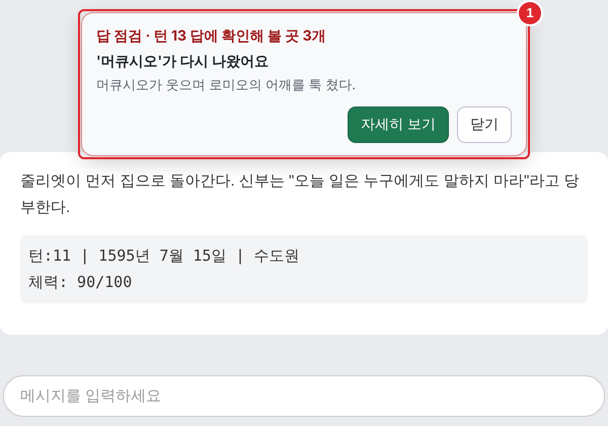

① **알림**: 화면 위 가운데에 뜹니다. 몇 턴 답에 확인해 볼 곳이 몇 개인지, 첫째 곳과 그 문장을 보여 줍니다.

* **자세히 보기**를 누르면 패널이 **답 점검 › 점검 결과**로 열립니다.
* 알림은 20초 뒤 사라집니다. 마우스를 올려 두면 기다립니다.
* 알림이 사라져도 결과를 볼 때까지 배지 옆에 **점검 N**이 남습니다.
* 크랙이 답을 다 쓴 뒤에 점검합니다. 그래서 답이 끝나고 10~20초 뒤에 뜹니다.
* 채팅을 처음 열었을 때 이미 있던 마지막 답은 점검만 하고 알림은 띄우지 않습니다.

### 점검 결과

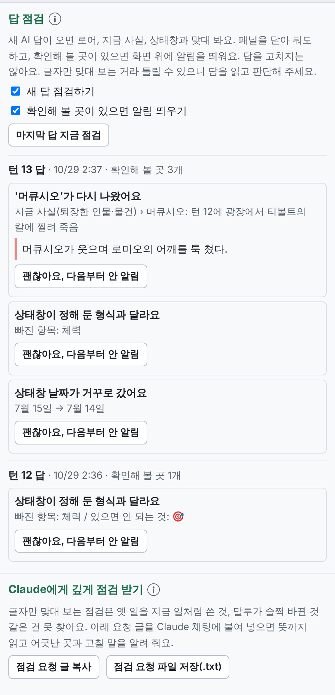

1. **새 답 점검하기**: 끄면 새 답을 점검하지 않습니다.
2. **확인해 볼 곳이 있으면 알림 띄우기**: 끄면 알림은 안 띄우고 배지에 **점검 N**만 보입니다.
3. **마지막 답 지금 점검**: 패널을 열 때 읽은 마지막 답을 바로 점검합니다. 지금 사실을 고친 뒤 다시 볼 때 씁니다.
4. 최근 답 다섯 개의 결과가 새것부터 보입니다. 곳마다 무엇과 어긋나는지와 그 문장이 나옵니다.
5. **괜찮아요, 다음부터 안 알림**: 그 곳은 이 채팅에서 다시 알리지 않습니다. 바로 나오는 **되돌리기**나 **점검 설정**의 **다시 알리기**로 돌립니다.

| 알리는 것 | 이럴 때 |
|---|---|
| 퇴장한 인물·없어진 물건이 다시 나옴 | 지금 사실의 **퇴장한 인물·물건**에 쓴 것이나, 내용에 죽음·사망·잃어버림이 적힌 인물과 물건이 지금 장면에 나올 때. 기억하거나 떠올리는 문장은 빼고 봅니다. |
| 모르는 것을 아는 듯함 | **누가 무엇을 아는지**에 `모름:`으로 적은 것을 그 인물이 알고 있었다, 들었다처럼 말할 때 |
| 안 쓰기로 한 말이 나옴 | `'선배' 대신 '오빠'`, `'선배'라고 부르지 않음`처럼 적은 말이 그 인물의 대사에 나올 때. 대사 앞뒤 글에서 말한 사람을 찾고, 다른 인물이 한 말이면 알리지 않습니다 |
| 상태창 형식이 다름 | 상태창 점검을 켠 작품에서 상태창이 정해 둔 형식과 다를 때 |
| 상태창 시간이 거꾸로 감 | 상태창의 날짜나 날짜·시각이 앞 턴보다 앞설 때. 시각만 있으면 밤을 넘겼을 수 있어 보지 않습니다. |
| 상태창 숫자가 크게 바뀜 (처음엔 꺼짐) | 숫자 칸이 앞 턴보다 정해 둔 수만큼 넘게 바뀔 때 |

* 글자만 맞대 보는 점검이라 틀릴 수 있습니다. 알림이 뜨면 답을 읽고 판단하십시오.
* 상태창은 **상태창 관리**에서 상태창 점검을 켠 작품만 봅니다.
* 로어는 켜 둔 것만, 지금 사실은 **보낼 때 지금 사실 붙이기**를 꺼 두어도 봅니다.
* 결과는 채팅마다 최근 답 20개까지 이 기기에 남깁니다.

### Claude에게 깊게 점검 받기

옛 일을 지금 일처럼 쓴 것, 말투가 슬쩍 바뀐 것처럼 뜻을 읽어야 찾는 것은 글자만 맞대서는 못 찾습니다. 이럴 때 쓰시는 AI에게 맡깁니다. 도우미가 AI를 부르지 않으니 비용이 들지 않습니다.

1. **점검 결과** 아래 **점검 요청 글 복사**를 누릅니다. 파일이 편하면 <strong>점검 요청 파일 저장(.txt)</strong>을 누릅니다.
2. Claude 같은 AI 대화창에 붙여 넣습니다(파일이면 올립니다).
3. AI가 어긋난 문장, 근거(어느 자료의 무엇과 어긋나는지), 고칠 말을 한 줄씩 알려 줍니다. 고칠 곳이 있으면 고쳐 쓴 답 전체도 줍니다.
4. 고쳐 쓴 답으로 바꾸려면 AI 답을 통째로 복사해 바로 아래 **고쳐 쓴 답으로 바꾸기** 칸에 붙여 넣습니다. 바뀌는 줄(지운 줄과 더한 줄)이 보이면 <strong>이 답으로 바꿔 넣기</strong>를 누릅니다. 크랙 화면은 새로 고쳐야 바뀐 글이 보입니다.

* 요청 글에는 마지막 답과 앞 3턴, 켜 둔 로어, 이 채팅의 지금 사실, 도우미가 찾은 곳이 들어갑니다.
* 장기기억에서는 점검할 답에 나온 낱말로 고른 칸(10칸, 5000자까지)과 직접 쓴 칸(규칙·설정, 6000자까지)이 들어갑니다. 그래서 몇 턴 앞이 아니라 오래전 일과 어긋난 것도 찾습니다.
* 상태창 점검을 켠 작품이면 상태창 형식(있어야 할 항목과 형식을 지킨 상태창 하나)도 들어갑니다.
* 바꿔 넣는 답은 점검 요청 글을 만든 답입니다. 그 사이 다시 생성해 그 답이 없으면 마지막 답에 넣고 그렇다고 알려 드립니다.
* AI 답에 숨겨 붙인 줄은 그대로 남깁니다. 고쳐 쓴 답에 그림 링크, 제작자가 숨겨 둔 줄(`[//]: #`), 상태창이 빠졌거나 답이 절반보다 짧으면 넣기 전에 알려 드립니다.
* **되돌리기**를 누르면 바꾸기 전 글로 돌아갑니다(최근 5번까지). 바꾼 뒤 그 답을 또 고쳤으면 한 번 더 묻습니다.
* 요청 글에는 무엇을 찾고 무엇은 어긋난 것으로 치지 않는지(새 인물이 처음 나옴, 문체, 인물의 거짓말 등), 근거를 꼭 대라는 규칙이 들어 있습니다. 근거를 댈 수 없는 짐작은 알리지 않습니다.

### 점검 설정 (고급)

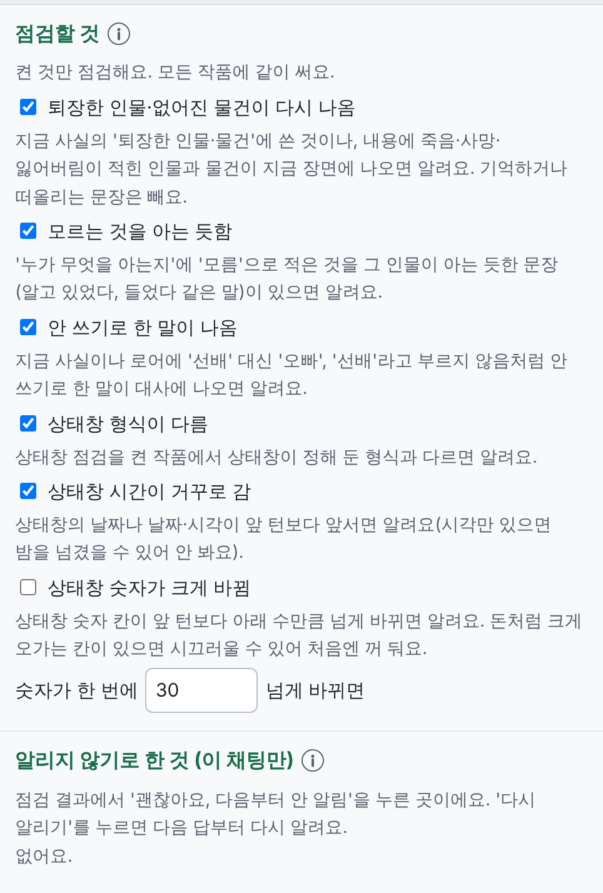

* **점검할 것**: 위 표의 점검을 하나씩 켜고 끕니다. 모든 작품에 같이 씁니다.
* **숫자가 한 번에 N 넘게 바뀌면**: 상태창 숫자가 크게 바뀜을 켰을 때의 기준 수입니다. 처음엔 30입니다.
* **되돌리기**: 점검 설정을 바꾸기 전으로 돌립니다. 점검 결과의 두 단추를 바꾼 것도 여기서 돌립니다.
* **알리지 않기로 한 것 (이 채팅만)**: **괜찮아요**를 누른 곳입니다. **다시 알리기**를 누르면 다음 답부터 다시 알립니다.

---

## 10 내 글 넣기

내가 직접 쓴 장기기억 칸(규칙 같은 것)과 유저노트를 묶음으로 저장해 두고, 채팅마다 한 번에 넣습니다.
새 채팅을 시작할 때마다 같은 규칙 칸을 하나씩 손으로 추가하지 않아도 됩니다.

**처음 상태:** 빈 묶음 **기본** 하나가 있습니다. 묶음은 모든 작품에 같이 쓰고, 동기화를 켜 두면 다른 기기에도 갑니다.

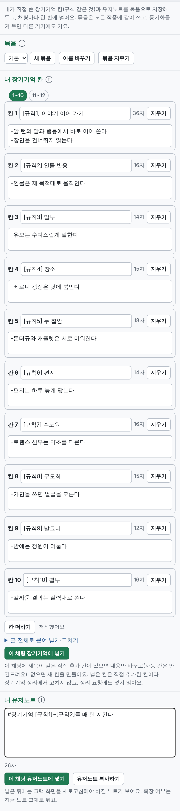

### 묶음

쓰는 봇에 따라 다른 묶음을 골라 씁니다. 예: **기본**, **대리 서술 막기**

| 단추 | 하는 일 |
|---|---|
| 새 묶음 | 빈 묶음을 만듭니다. |
| 이름 바꾸기 | 고른 묶음의 이름을 바꿉니다. |
| 묶음 지우기 | 고른 묶음을 지웁니다. 바로 아래 **되돌리기**로 돌릴 수 있습니다. |

### 내 장기기억 칸

1. **글 전체로 붙여 넣기·고치기**를 펼치고 규칙 모음을 통째로 붙여 넣습니다. `[제목]`으로 시작하는 줄마다 칸이 나뉩니다. 쓰는 대로 저장됩니다.
   ```
   [규칙1] 입력 처리
   -기억 우선: 장기기억이 설정보다 앞선다
   -정보 비대칭: 같이 없던 일은 모른다

   [규칙2] 인물 반응
   -NPC는 제 목적대로 움직인다
   ```
2. 나뉜 칸은 **칸 1, 칸 2 …** 상자로 보입니다. 10칸이 넘으면 **1~10**, **11~20**처럼 작은 탭으로 나뉩니다. 칸마다 제목과 내용을 따로 고치고, 글자 수를 봅니다. 제목은 20자, 내용은 300자까지입니다. 제목 끝의 ` · 295자` 같은 글자 수 메모는 빼고 넣습니다.
   * **칸 더하기**로 새 칸을 만들고, 칸의 **지우기**로 지웁니다. 지운 칸이나 글 전체로 바꾼 것은 바로 아래 **칸 되돌리기**로 돌립니다.
   * 제목은 `[`로 시작해야 합니다. 아니면 그 칸에 빨간 알림이 뜹니다.
3. **이 채팅 장기기억에 넣기**를 누르면 새 칸, 바꿀 칸, 그대로인 칸이 몇 개인지 알려 줍니다. 한 번 더 누르면 넣습니다.

* 이 채팅에 제목이 같은 직접 추가 칸이 있으면 내용만 바꾸고(자동 칸은 제목이 같아도 건드리지 않습니다), 없으면 새 칸을 만듭니다. 이미 같은 내용이면 건드리지 않습니다.
* 새 칸은 한 묶음으로 자동 경과 칸보다 앞(오래된 쪽)에 들어갑니다. 묶음 안에서는 차례대로, 이미 있는 내 칸 바로 옆에 붙습니다. 크랙이 자리 넣기를 받지 않으면 맨 뒤에 넣고 알려 줍니다.
* 넣은 칸은 직접 추가한 칸입니다. 장기기억 정리는 이 칸을 고치지 않고, 정리 요청에도 넣지 않습니다.
* 넣은 것은 **되돌리기**로 넣기 전으로 돌립니다. 새 칸은 지우고, 바꾼 칸은 원래 내용으로 돌립니다. 넣은 뒤 크랙에서 또 바꾼 칸은 건드리지 않습니다.

### 내 유저노트

크랙 유저노트에 넣을 글을 적어 둡니다.

1. **이 채팅 유저노트에 넣기**를 누르면 지금 유저노트를 몇 자짜리 글로 바꾸는지 알려 줍니다. 한 번 더 누르면 넣습니다.
2. 넣은 뒤에는 크랙 화면을 새로고침하십시오. 새로고침 전에 크랙의 유저노트 창에서 저장하면 옛 글로 덮입니다.

* 지금 유저노트를 이 글로 통째로 바꿉니다. 확장 여부는 지금 노트 그대로 둡니다.
* **유저노트 되돌리기**는 넣기 전 글로 돌립니다. 넣은 뒤 크랙에서 또 고쳤으면 건드리지 않습니다.
* **유저노트 복사하기**는 글만 복사합니다. 직접 붙여 넣고 싶을 때 씁니다.

---

## 11 설정

### 화면

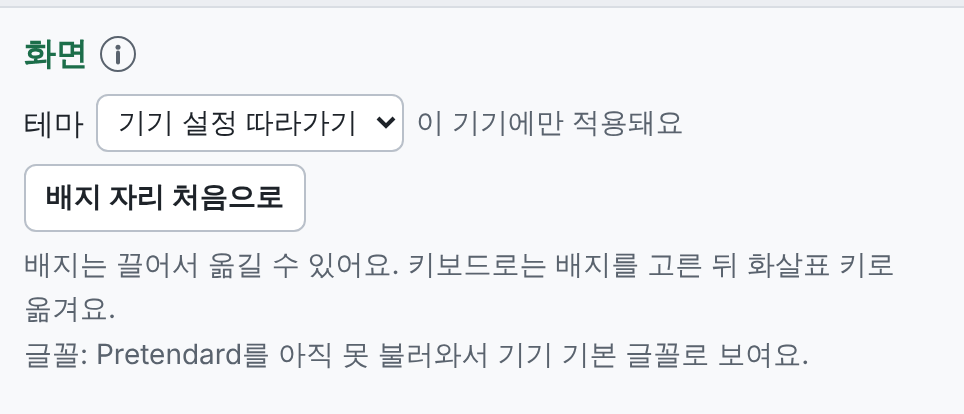

* **테마**: 기기 설정 따라가기, 밝게, 어둡게. 이 기기에만 적용됩니다.
* **배지 자리 처음으로**: 옮긴 배지를 원래 자리로 돌립니다.

### 데이터 관리

도우미가 저장한 것을 다루는 곳입니다. 아래 다섯 칸이 접는 칸으로 들어 있고, 칸마다 따로 펴고 접습니다.

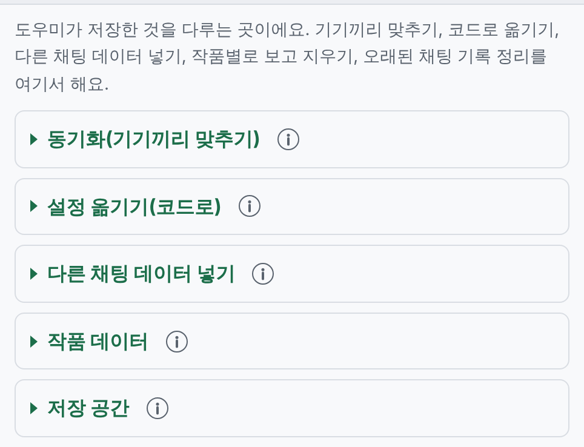

| 접는 칸 | 하는 일 |
|---|---|
| 동기화(기기끼리 맞추기) | 내 깃허브 비공개 저장소로 PC와 휴대폰의 설정을 맞춥니다. |
| 설정 옮기기(코드로) | 동기화 없이 설정 코드 하나로 다른 기기에 옮깁니다. |
| 다른 채팅 데이터 넣기 | 분기한 채팅으로 이사하듯 다른 채팅의 도우미 데이터, 장기기억, 유저노트를 지금 채팅에 넣습니다. |
| 작품 데이터 | 작품마다 저장한 것을 보고 골라서 지웁니다. |
| 저장 공간 | 오래 안 연 채팅이나 크랙에서 지운 채팅의 도우미 기록을 지웁니다. |

#### 동기화 (기기끼리 맞추기)

작품 설정, 로어, 지금 사실, 공통 설정을 PC와 휴대폰에서 똑같이 쓰게 합니다.
내 깃허브 **비공개** 저장소에 파일 하나로 두고, 같은 값을 두 기기에서 바꿨으면 나중에 바꾼 쪽을 따릅니다.

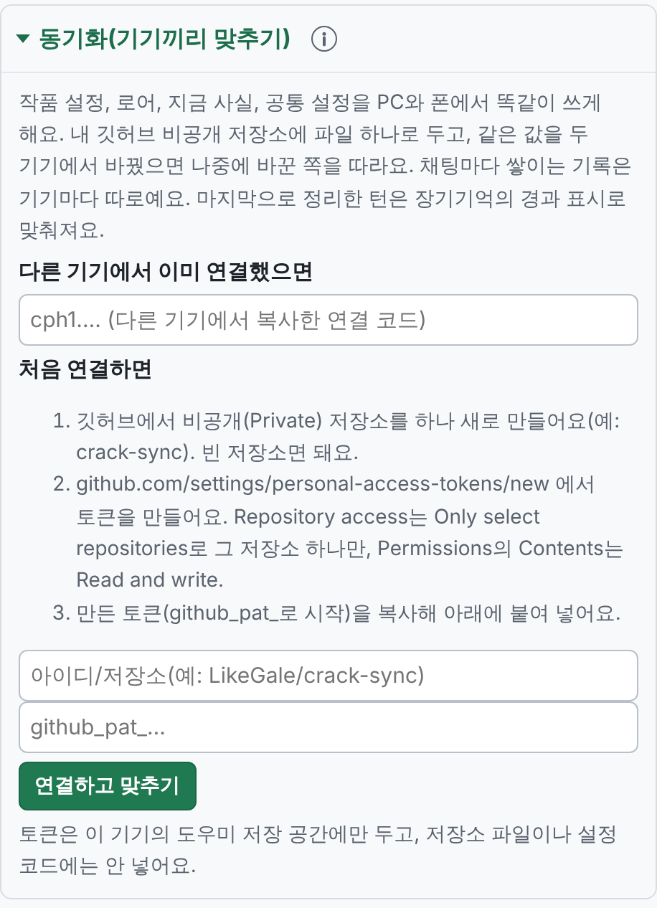

처음 연결(한 기기에서)

1. 깃허브에서 **비공개(Private)** 저장소를 하나 새로 만듭니다. 예: `crack-sync`
2. https://github.com/settings/personal-access-tokens/new 에서 토큰을 만듭니다.
   * Repository access: **Only select repositories** → 방금 만든 저장소 하나
   * Permissions › Repository permissions › **Contents: Read and write**
3. **설정 › 데이터 관리 › 동기화**에 저장소(`아이디/저장소`)와 토큰(`github_pat_…`)을 붙여 넣고 **연결하고 맞추기**를 누릅니다.

다른 기기에서

1. 연결한 기기에서 **연결 코드 복사**를 두 번 누릅니다.
2. 다른 기기의 **설정 › 데이터 관리 › 동기화**에서 연결 코드 칸에 붙여 넣고 **연결하고 맞추기**를 누릅니다.

* 연결 코드에는 토큰이 들어 있습니다. 남에게 보이지 마십시오.
* 토큰은 그 기기의 도우미 저장 공간에만 둡니다. 저장소 파일이나 설정 코드에는 넣지 않습니다.
* 받은 값이 마음에 들지 않으면 **방금 받은 것 되돌리기**를 누릅니다.

#### 설정 옮기기

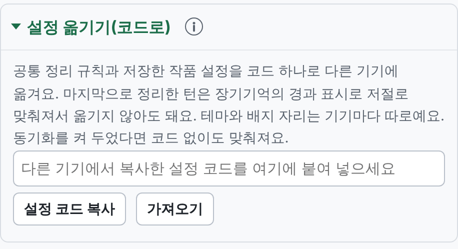

동기화 없이 **설정 코드 복사**를 눌러 다른 기기의 같은 칸에 붙여 넣고 **가져오기**를 누르면, 공통 정리 규칙과 작품 설정이 옮겨집니다.
테마와 배지 자리는 기기마다 따로입니다.

#### 다른 채팅 데이터 넣기

도우미는 지금 사실, 어디까지 정리했는지 같은 것을 채팅마다 따로 저장합니다. 크랙에서 채팅을 분기하면 새 채팅에는 이것도, 장기기억도 비어 있습니다. 여기서 원래 채팅을 골라 지금 채팅으로 이사하듯 옮깁니다.

1. 넣을 채팅을 열고 **설정 › 데이터 관리 › 다른 채팅 데이터 넣기**를 폅니다.
2. 목록에서 가져올 채팅을 고릅니다. 같은 작품 채팅이 먼저, 최근에 연 차례로 나옵니다. 줄마다 그 채팅의 마지막 내 입력과 마지막 응답, 마지막으로 연 때, 어디까지 정리했는지가 보입니다. 헷갈리면 **새 탭에서 열어 보기**로 그 채팅을 열어 봅니다.
3. **고른 채팅에서 넣기**를 누르면 두 채팅을 읽고 무엇을 넣을지 알려 줍니다. 한 번 더 누르면 넣습니다.
   - 도우미 데이터: 지금 사실, 정리한 턴, 상태창 규칙 보내기, 답 점검에서 넘긴 것, 로어·기억을 붙인 턴
   - 크랙 장기기억: 원래 채팅과 똑같아지게 덮어씁니다. 앞에서부터 같은 칸은 두고, 차례나 내용이 다른 칸부터는 지운 뒤 원래 채팅 차례대로 넣습니다. 칸이 많으면 몇 분 걸립니다.
   - 유저노트: 원래 채팅의 유저노트로 바뀝니다.

* 잘못 넣었거나 중간에 끊기면 한 번 더 누릅니다. 다시 원래 채팅과 똑같이 맞춥니다.
* 작품 설정과 로어는 작품마다 같이 쓰므로 넣지 않아도 됩니다. 대화 기록은 옮기지 않습니다.
* 넣은 것은 **넣기 전으로 되돌리기**로 돌립니다. 여러 번 넣었어도 처음 넣기 전으로 돌립니다. 넣은 장기기억 칸은 지우고, 지웠던 칸은 차례대로 다시 넣고, 유저노트와 도우미 데이터는 넣기 전으로 돌립니다. 넣은 뒤 고친 칸은 지우지 않습니다.
* 넣은 뒤에는 패널을 닫았다 열면 반영됩니다.

#### 작품 데이터

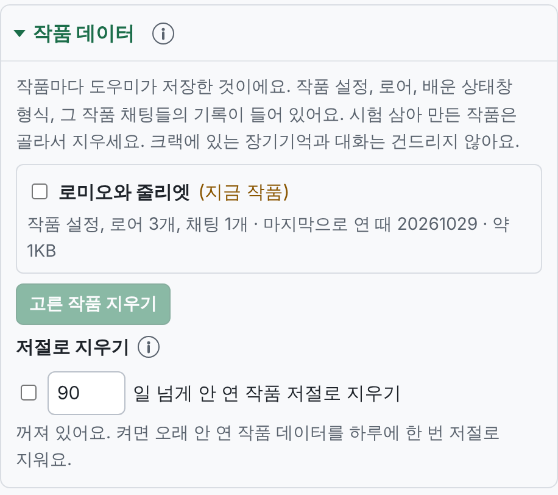

* 작품마다 도우미가 저장한 것(작품 설정, 로어, 배운 상태창 형식, 그 작품 채팅들의 기록)을 보여 줍니다.
* 시험 삼아 만든 작품을 골라 **고른 작품 지우기**를 두 번 누르면 지워집니다. 크랙의 대화와 장기기억은 지우지 않습니다.
* 잘못 지웠으면 **방금 지운 것 되돌리기**를 누릅니다.
* **저절로 지우기**를 켜면 며칠(처음 90일) 넘게 안 연 작품 데이터를 하루에 한 번 지웁니다. 처음엔 꺼져 있습니다.

#### 저장 공간

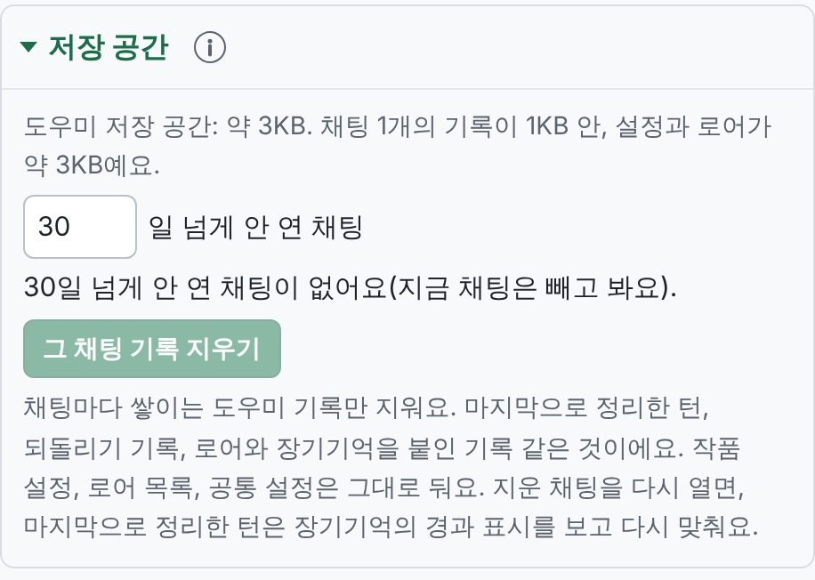

* 며칠(처음 30일) 넘게 안 연 채팅의 도우미 기록(마지막으로 정리한 턴, 되돌리기, 붙인 기록 같은 것)을 지웁니다.
* 작품 설정, 로어 목록, 공통 설정은 그대로 둡니다. 지금 채팅은 지우지 않습니다.

**지운 채팅 기록**

크랙에서 채팅을 지워도 도우미 기록은 남습니다. 날짜와 상관없이 지운 채팅만 골라 지웁니다.

1. **지운 채팅 찾기**를 누릅니다. 이 기기에 기록이 있는 채팅을 하나씩 크랙에서 읽어 봅니다.
2. 크랙에 없는 채팅(지운 채팅)이 모여 보입니다. 처음부터 골라져 있습니다.
3. **고른 채팅 기록 지우기**를 두 번 누릅니다. 그 채팅의 지금 사실까지 모두 지웁니다.

* 크랙이 다른 까닭으로 답하지 않은 채팅은 **있는지 확인하지 못한 채팅**으로 따로 보입니다(예: 크랙 403). 처음엔 안 골라져 있습니다. 지운 채팅이 맞을 때만 골라서 지우십시오.
* **다른 채팅 데이터 넣기** 목록에서도 지운 채팅은 **크랙에 없는 채팅이에요**로 보이고 고를 수 없습니다. 그 자리의 **이 채팅 기록 지우기**로 바로 지웁니다.
* 지운 것은 페이지를 새로 고치기 전까지 **방금 지운 것 되돌리기**로 돌립니다.

---

## 12 되돌리기

바꾸는 기능에는 모두 되돌리기가 있습니다.

| 바꾼 것 | 되돌리는 곳 |
|---|---|
| 장기기억에 넣은 경과 | ② AI 답을 장기기억에 넣기 › 되돌리기 |
| 바꾼 상태창(점검 결과·항목 빼기·고쳐 쓰기) | 상태창 관리 › 점검 결과 맨 위 › 되돌리기 |
| 작품 설정 저장 | 작품 줄 아래 또는 작품 설정 맨 아래 › 저장 전으로 |
| 공통 규칙 저장 | 공통 규칙 저장 옆 › 저장 전으로 |
| 로어 목록 | 보낼 때 붙이기 › 로어 › 되돌리기 |
| 지금 사실 | 보낼 때 붙이기 › 지금 사실 › 되돌리기 |
| 답 점검 설정 | 답 점검 › 점검 설정<strong>(고급)</strong> › 되돌리기 |
| 괜찮아요(다음부터 안 알림) | 그 자리 › 되돌리기, 또는 답 점검 › 점검 설정<strong>(고급)</strong> › 다시 알리기 |
| 크랙 기록에서 뺀 블록 | 보낼 때 붙이기 › 붙인 기록<strong>(고급)</strong> › 다시 넣기 |
| AI가 따라 써서 뺀 숨긴 글 | 보낼 때 붙이기 › 붙인 기록<strong>(고급)</strong> › 다시 넣기 |
| 로어 설정(숨겨 붙이기 포함) | 보낼 때 붙이기 › 로어 › 되돌리기 |
| 내 글 넣기로 넣은 장기기억 칸 | 내 글 넣기 › 되돌리기 |
| 내 글 넣기로 넣은 유저노트 | 내 글 넣기 › 유저노트 되돌리기 |
| 지운 묶음 | 내 글 넣기 › 묶음 › 되돌리기 |
| 동기화로 받은 값 | 설정 › 데이터 관리 › 동기화 › 방금 받은 것 되돌리기 |
| 다른 채팅에서 넣은 데이터 | 설정 › 데이터 관리 › 다른 채팅 데이터 넣기 › 넣기 전으로 되돌리기 |
| 지운 작품 데이터 | 설정 › 데이터 관리 › 작품 데이터 › 방금 지운 것 되돌리기 |
| 지운 채팅 기록 | 설정 › 데이터 관리 › 저장 공간 › 방금 지운 것 되돌리기(페이지를 새로 고치기 전까지). 다른 채팅 데이터 넣기 목록에서 지웠으면 그 아래 방금 지운 기록 되돌리기 |

* 되돌리지 못한 장기기억 칸은 **원래 내용 복사**로 직접 넣을 수 있습니다.

---

## 13 주의사항

1. 도우미는 직접 추가한 장기기억 칸을 처음 설정으로는 고치지 않습니다. **정리 설정 › 직접 추가한 장기기억**<strong>(고급)</strong>에서 **직접 추가한 장기기억도 고치기**를 켰을 때만 고칩니다.
2. 장기기억에 넣는 사이 크랙에서 장기기억이 바뀌면 넣기를 멈춥니다. 창 두 개에서 동시에 넣지 않도록 막습니다.
3. 상태창을 바꾸면 크랙 화면을 새로 고칩니다. 보내지 않은 입력이 있으면 먼저 보내거나 복사해 두십시오.
4. 요청 파일과 장기기억 파일에는 대화 내용이 들어 있습니다. 남에게 보내지 마십시오.
5. 동기화 토큰과 연결 코드는 남에게 보이지 마십시오.
6. 턴 표시는 응답마다 1씩 늘어나는 번호여야 정확합니다. 날짜(`Day 3`)처럼 크게 뛰는 숫자는 **응답 수로** 세는 편이 낫습니다.

---

## 14 문제가 생겼을 때

| 증상 | 확인할 것 |
|---|---|
| 배지가 안 보입니다 | 크랙 채팅 화면을 새로 고칩니다. Tampermonkey <strong>대시보드(Dashboard)</strong>에서 도우미가 <strong>사용(Enabled)</strong>으로 켜져 있는지 확인합니다. |
| 턴이 맞지 않습니다 | 고급 기능을 열고 **장기기억 정리 › 정리 설정**의 **턴 세는 법**과 **턴 표시 모양**을 확인합니다. |
| 상태창을 못 찾습니다 | 안내 바로 아래에서 상태창 코드 블록 이름을 고치거나, 이 채팅에 나온 이름 단추를 누릅니다. |
| 로어가 안 붙습니다 | **보낼 때 로어 붙이기**가 켜져 있는지, **시험해 보기**에서 붙는지 확인합니다. |
| 설정이 사라집니다 | 시크릿 창이면 02의 시크릿 모드 설정을 확인합니다. |
| 사용법 보기가 안 열립니다 | Tampermonkey가 접속을 물었을 때 <strong>거부(Forbid)</strong>를 눌렀거나 팝업이 막혔을 수 있습니다. 그때는 깃허브의 사용법 페이지가 대신 열립니다. |
| 그 밖의 문제 | 머리줄의 **진단 복사**를 눌러 그 내용을 보내 주십시오. 대화 내용과 이름은 들어가지 않습니다. |

### 자주 묻는 것

**Q. 돈이 드나요?**

A. 도우미는 AI를 직접 부르지 않습니다. 정리는 쓰시는 AI 대화창에 요청 글을 붙여 넣어서 합니다. 그래서 도우미 때문에 드는 비용은 없습니다.

**Q. 크랙 대화가 바뀌나요?**

A. 보낼 때 붙이기는 보내는 글 앞에 블록을 붙입니다. 입력 칸에 쓴 글은 그대로이고, 붙인 블록은 크랙 기록에 남았다가 8턴 뒤 빠집니다. **AI 답에 숨겨 붙이기**를 켜면 내 입력 대신 바로 앞 AI 답 끝에 안 보이게 붙입니다. 장기기억과 상태창은 내가 누를 때만 바꾸고, 모두 되돌릴 수 있습니다.

**Q. 채팅 페이지를 닫아도 도우미가 일하나요?**

A. 아닙니다. 크랙 채팅 페이지가 열려 있을 때만 일합니다. 다시 열면 대화를 읽어 턴을 다시 셉니다.

**Q. 언제 정리해야 하나요?**

A. 배지가 빨개진 뒤 편할 때 하시면 됩니다. 정리할 범위는 지난번 정리 다음 턴부터 지금 턴까지로 저절로 채워집니다.

**Q. 로어나 지금 사실을 꼭 써야 하나요?**

A. 아닙니다. 경과 정리만 써도 됩니다. 로어 목록에 넣어 둔 로어는 **보낼 때 로어 붙이기**를 켜기 전까지 붙지 않습니다.

**Q. 여러 작품에 써도 되나요?**

A. 네. 작품 설정과 로어는 작품마다, 지금 사실과 붙인 기록은 채팅마다 따로 저장합니다.

**Q. 시크릿 창에서 써도 되나요?**

A. 시크릿 창을 닫으면 도우미 설정이 사라질 수 있습니다. **02 설치 및 업데이트**의 시크릿 모드 설정을 바꾸거나, 동기화를 연결해 두면 다시 열 때 받아 옵니다.

**Q. 답 점검 알림이 틀리게 떠요.**

A. 답 점검은 글자만 맞대 보므로 틀릴 수 있습니다. 그 곳만 **괜찮아요, 다음부터 안 알림**을 누르시고, 같은 종류가 자주 틀리면 <strong>답 점검 › 점검 설정<strong>(고급)</strong></strong>에서 그 점검을 끄십시오.

**Q. AI 답 끝에 이상한 글이 보여요.**

A. `[cph-note]`나 `<!-- cph-note`로 시작하는 글이면 **AI 답에 숨겨 붙이기**로 붙인 글입니다. 가장 최근 답 끝에 잠깐 보였다가 사라지면, AI가 숨긴 글을 따라 쓴 것을 도우미가 뺀 것입니다(**이 답은 잘렸을 수 있어요** 알림이 뜹니다). 자주 그러면 **숨길 자리**를 맨 앞으로 바꿔 보십시오. 사라지지 않고 계속 보이면 **로어 설정**<strong>(고급)</strong>에서 숨겨 붙이기를 끄시고, **붙인 기록**의 **크랙 기록에서 빼기**로 빼십시오. 진단 복사와 함께 알려 주시면 고치겠습니다.

**Q. 로어를 붙이는 다른 확장과 함께 써도 되나요?**

A. 함께 켜면 같은 설정이 두 번 붙을 수 있습니다. 붙이기는 한쪽만 켜 두십시오.

**Q. 이상하게 움직이면 어떻게 하나요?**

A. 패널 머리줄의 **진단 복사**를 눌러 그 내용과 함께, 무엇을 눌렀을 때 어떻게 됐는지 알려 주십시오.

---

## 15 업데이트 내역

| 버전 | 바뀐 것 |
|---|---|
| 1.50.39 | **답 점검**: Claude가 고쳐 쓴 답을 붙여 넣어 그 AI 답을 통째로 바꿉니다(**고쳐 쓴 답으로 바꾸기**, 되돌리기 포함). 점검 요청 글은 고칠 곳이 하나라도 있으면 고쳐 쓴 답 전체를 달라고 합니다. |
| 1.50.38 | **답 점검**: Claude에게 보내는 점검 요청 글에 이 답과 관련된 장기기억, 직접 쓴 장기기억, 상태창 형식이 들어갑니다. 찾을 것과 찾지 않을 것, 근거를 대는 규칙, 답 예시를 더했습니다. |
| 1.50.37 | **답 넣기**: 글자 수가 머리줄과 다르다는 문제 표시를 모두 뺐습니다(코드 블록 없이 복사한 답도). 본문 마지막 '-' 줄 뒤에 AI 맺음말이 붙어 있으면 떼고 알려 드립니다. |
| 1.50.36 | **AI 답에 숨겨 붙이기**: 더 많은 화면에서 숨겨지는 모양으로 바꿨습니다. **숨길 자리**(끝/맨 앞)를 고를 수 있습니다. AI가 숨긴 글을 따라 써서 뺐으면 **이 답은 잘렸을 수 있어요** 알림이 뜹니다. **진단 복사**에 모든 설정 값이 들어갑니다(글 내용은 빼고). |
| 1.50.35 | **저장 공간**: **지운 채팅 찾기**로 크랙에서 지운 채팅의 기록만 모아 보고 지웁니다. **다른 채팅 데이터 넣기** 목록에서도 지운 채팅은 고를 수 없고 바로 지울 수 있습니다. |
| 1.50.34 | **AI 답에 숨겨 붙이기**: 붙인 뒤 크랙에서 다시 읽어 정말 들어갔는지 확인합니다. 안 들어갔으면 그 턴은 내 입력 앞에 붙입니다. |
| 1.50.33 | **장기기억 붙이기**: '가장 최근 N칸은 빼고'에서 직접 쓴 칸(규칙·설정)은 세지 않습니다. 최근 칸은 크랙 화면 차례로 셉니다. |
| 1.50.32 | **다른 채팅 데이터 넣기**: 장기기억을 원래 채팅과 똑같이 덮어씁니다. 잘못 넣었으면 다시 누르면 바로잡힙니다. |
| 1.50.31 | 크랙의 '이 위/아래에 추가'나 **내 글 넣기**로 중간에 끼워 넣은 장기기억 칸을 크랙 화면 차례 그대로 봅니다. 다른 채팅 데이터 넣기도 그 차례로 옮깁니다(전에는 맨 뒤로 갔습니다). |
| 1.50.30 | **다른 채팅 데이터 넣기**: 크랙 장기기억과 유저노트도 함께 옮깁니다. 끊기면 다시 눌러 이어서 넣고, 되돌리기는 넣은 칸을 지웁니다. |
| 1.50.29 | **다른 채팅 데이터 넣기**: 가져올 채팅을 목록에서 고릅니다. 줄마다 마지막 내 입력·응답, 마지막으로 연 때, 정리한 턴, 열어 보기 링크가 보입니다. |
| 1.50.28 | **설정 › 데이터 관리 › 다른 채팅 데이터 넣기**: 분기한 채팅처럼 다른 채팅의 지금 사실, 정리한 턴 같은 도우미 데이터를 통째로 지금 채팅에 넣습니다. 되돌리기로 돌릴 수 있습니다. |
| 1.50.27 | **내 글 넣기**: 새 칸을 한 묶음으로 자동 경과 칸 앞(오래된 쪽)에 넣습니다(크랙의 '이 글 앞/뒤에 넣기'와 같은 방법). |
| 1.50.26 | **진단 복사**: 장기기억 칸을 넣는 자리(앞·뒤) 값을 보여 주고, 화면 기록 요청은 뺍니다. |
| 1.50.25 | **내 글 넣기**: 붙여 넣은 장기기억 칸을 칸별 상자로 나눠 보여 주고, 10칸씩 작은 탭으로 묶습니다. 칸마다 고치기·지우기(칸 되돌리기)·더하기. |
| 1.50.24 | 정리 요청: 경과 본문을 **때·인물·일·전개** 줄로 받고, 머리줄에 글자 수를 받지 않습니다(글자 수 다름 알림 없음). **내 글 넣기**는 제목이 같아도 자동 칸은 고치지 않고 새 칸으로 넣습니다. |
| 1.50.23 | **내 글 넣기**에서 유저노트도 이 채팅에 바로 넣습니다(되돌리기 있음). |
| 1.50.22 | 진단 복사가 크랙 요청의 안쪽 모양까지 적습니다(유저노트 넣기 준비). 보낸 글은 적지 않습니다. |
| 1.50.21 | 새 메뉴 **내 글 넣기**: 직접 쓴 장기기억 칸(규칙 같은 것)과 유저노트를 묶음으로 저장해 두고, 채팅마다 장기기억에 한 번에 넣습니다(되돌리기 있음). 유저노트는 복사해서 붙여 넣습니다. 정리 요청에는 경과가 든 직접 추가 칸만 넣습니다. |
| 1.50.20 | 턴 표시 모양에 'TN-'처럼 영어 글자 바로 뒤에 붙은 N도 쓸 수 있습니다. 'T12-3일차'처럼 T 바로 뒤 숫자가 턴인 작품에서 씁니다. |
| 1.50.19 | 정리 요청 파일에 '사실을 정확히' 규칙을 더했습니다. 누가 한 일인지 바꾸지 않기, 하려 한 일과 해낸 일 나눠 쓰기, 뭉뚱그리지 않고 기록의 말로 쓰기('거짓말로 둘러댐' 말고 '산책 갔다고 둘러댐'), 그·그녀 대신 이름 쓰기입니다. |
| 1.50.18 | 나눈 요청 파일에 장기기억 칸 목록과 그대로 줄을 넣지 않아 AI 답이 짧아집니다. AI는 파일마다 경과1부터 쓰고, 도우미가 파일 순서대로 칸 번호를 이어 붙입니다. 로어·지금 사실 목록도 그 파일 대화에 나오는 것만 넣습니다. |
| 1.50.17 | 답을 넣을 장기기억 칸을 경과 번호 순서대로만 고릅니다. 경과1은 가장 오래된 자동 칸, 경과2는 그다음 칸입니다. AI가 적은 칸 제목은 보지 않습니다. |
| 1.50.16 | 휴대폰처럼 화면이 좁으면 머리줄이 두 줄이 되어 버전이 잘리지 않습니다. 윗줄에 이름·버전과 닫기, 아랫줄에 나머지 단추가 있습니다. |
| 1.50.15 | 장기기억에 제목이 같은 칸이 여럿 있어도 막지 않고 덮어씁니다. 칸 번호가 맞는 칸, 아니면 이번에 아직 안 쓴 앞쪽 칸에 넣고 그 줄에 알립니다. 되돌리기로 돌릴 수 있습니다. |
| 1.50.14 | 요청 파일을 만든 뒤 장기기억 칸이 늘거나 줄어 칸 순서가 밀려도, 확실히 찾은 칸으로 밀린 만큼 맞춰 넣습니다. 같은 제목 칸이 여럿이면 아직 경과가 없는 칸을 고릅니다. |
| 1.50.13 | 장기기억 칸이 500개쯤 되면 '장기기억을 끝까지 못 읽었어요'로 넣지 못하던 것을 고쳤습니다. 2000칸까지 읽고, 중간에 한 번 못 읽은 쪽은 한 번 더 읽습니다. |
| 1.50.12 | 처음부터 다시 정리하면 경과 번호가 앞으로 당겨져 '더 최근 경과를 예전 범위로 덮어써요'로 막히던 것을 고쳤습니다. 그 칸의 턴을 같은 답의 다른 경과가 다시 쓰면 막지 않고 알리기만 합니다. |
| 1.50.11 | 나눠 받은 파일의 답을 파일 순서대로 그대로 이어 붙여 ②에 한 번에 넣을 수 있습니다. 도우미가 답을 나눠 읽고 하나로 합칩니다. 여러 답이 같은 칸을 고쳤으면 뒤 답을 쓰고 알려 줍니다. |
| 1.50.10 | 모두 정리해서 새로 정리할 턴이 없으면 정리할 범위 아래에 그렇게 알리고, 처음부터 다시(턴 1~지금 턴) 단추를 보여 줍니다. 되돌리기도 됩니다. |
| 1.50.9 | 범위가 길면 고른 AI(Haiku 6만 자, Sonnet 12만 자)가 읽을 만큼 나눈 요청 파일을 압축 파일 하나로 받습니다. 파일마다 새 AI 대화창에서 정리하고 답을 하나씩 넣습니다. 요청 파일에 꼭 지킬 것과 답 예시가 들어가고, 보낼 말 복사하기 단추가 생겼습니다. 한 턴만 적은 '턴75', 턴 범위 없는 머리줄도 읽습니다. |
| 1.50.8 | 50턴씩 나눈 요청 파일에서 로어와 지금 사실은 마지막 파일에만 묻습니다. 마지막 답은 앞 답까지 합친 문서 하나라서 그것만 ②에 넣으면 됩니다. AI가 경과 머리줄 여러 개를 한 줄에 이어 쓴 답도 하나씩 나눠 읽습니다. |
| 1.50.7 | 정리할 범위가 50턴보다 길면 요청 파일을 50턴씩 나눠 압축 파일(.zip) 하나로 받습니다. 복사는 전부 한 번에 합니다. AI 답이 꼴을 안 지켰거나, 요청 글을 다시 붙였거나, 장기기억을 옮겨 적기만 했으면 ②에서 알려 줍니다. |
| 1.50.6 | 답 점검이 대사를 한 사람을 더 잘 찾습니다. 누가 한 말인지 모르면 알림에 그렇게 적습니다. AI가 거절할 수 있는 장면 상자에서 인물을 모두 꺼도 상자가 남고, 인물 칸에 설명이 생겼습니다. |
| 1.50.5 | 정리할 범위에 AI가 거절할 수 있는 장면이 있으면, 지금처럼 전부 담은 요청과 그 장면을 빼고 빠진 자리를 표시한 요청 두 가지로 만들 수 있습니다. 뺀 턴은 따로 내려받습니다. |
| 1.50.4 | 1.50.3에서 더한 정리 요청의 장면 빼기를 다시 뺐습니다. 정리 요청은 1.50.2처럼 범위의 대화를 모두 담습니다. |
| 1.50.3 | 숨겨 붙인 글이 화면에 보이던 것을 고쳤습니다. 긴 채팅에서 패널이 빨리 열립니다. 정리 요청에서 AI가 거절할 장면을 빼고, 뺀 턴은 따로 내려받습니다. 답 점검이 대사 속 이름이나 '눈치'에 잘못 알리던 것과, '절대로 선배라고 부르지 않음' 같은 규칙을 못 읽던 것을 고쳤습니다. |
| 1.50.2 | 광고 차단 확장을 쓸 때 고급 기능을 열면 패널 안이 비던 것을 고쳤습니다. |
| 1.50.1 | 장기기억이 많은 채팅에서 시험해 보기와 보내기가 멈추던 것을 고쳤습니다. 숨겨 붙이기가 상태창 블록을 닫지 않는 작품에서도 됩니다. 답 점검의 호칭·말투는 그 인물이 한 말만 봅니다. 창으로 꺼낸 창의 테마가 페이지와 같아집니다. |
| 1.50.0 | 로어 설정에 **AI 답에 숨겨 붙이기**가 생겼습니다. 켜면 붙이는 글을 내 입력 대신 바로 앞 AI 답 끝에 안 보이게 붙입니다. |
| 1.49.0 | **답 점검**이 생겼습니다. 새 AI 답이 로어·지금 사실·상태창과 어긋나 보이면 화면 위에 알림을 띄웁니다. 지금 사실에 **퇴장한 인물·물건**이 생겼습니다. |
| 1.48.0 | 처음엔 기본 기능만 보입니다. 메뉴 맨 아래 **고급 기능 열기**를 누르면 고급 메뉴가 한꺼번에 생깁니다. |
| 1.47.0 | 지금 사실에 안 끝난 이야기, 누가 무엇을 아는지, 호칭과 말투, 중요한 물건이 생겼습니다. 지난 일을 물으면 장기기억을 먼저 붙입니다. |
| 1.46.1 | 리롤로 버린 응답을 장기기억 정리와 턴 세기에서 뺍니다. |
| 1.46.0 | 기능 칸이 왼쪽 메뉴로 바뀌었습니다(휴대폰과 좁은 창은 맨 아래 메뉴 단추). 로어마다 **늘 붙이기**, 대사 로어 앞의 '(당시 한 말)', 지운 입력에 붙였던 것을 다시 붙이는 **되감기**가 생겼습니다. 뜻으로는 1등 로어 하나만, 2등보다 확실히 높을 때 붙입니다. |
| 1.45.3 | 보낼 때 붙이기·설정 탭에서도 작은 탭 줄이 제자리에 있고, 아래 내용만 스크롤합니다. |
| 1.45.2 | 한 글자 이름은 '딤(인물)'처럼 종류를 달면 찾습니다. |
| 1.45.1 | 내 입력에 나온 로어는 바로 앞 응답에 있어도 점수를 깎지 않습니다. |
| 1.45.0 | 로어를 점수로 고르고, 왜 붙었는지 보여 줍니다. 장기기억은 직접 추가한 칸을 처음엔 붙이지 않습니다. 바뀐 규칙은 체크로 끌 수 있습니다. |
| 1.44.0 | 설정의 동기화, 설정 옮기기, 작품 데이터, 저장 공간을 **데이터 관리** 탭 하나로 모았습니다. 테마 단추가 아이콘으로 바뀌었습니다. |
| 1.43.0 | **뜻으로도 찾기**가 생겼습니다. 모델을 받아 두면 찾을 낱말이 없어도 뜻이 가까운 로어를 붙입니다. |
| 1.42.0 | 정리할 때 로어의 찾을 낱말을 비슷한 말까지 넓혀 받습니다. 띄어 쓴 낱말은 붙여 써도 찾습니다. |
| 1.41.3 | 이용 조건(LICENSE)을 적었습니다. |
| 1.41.2 | 내려받는 스크립트 크기를 줄였습니다. |
| 1.41.1 | 설명서와 안내 글을 다듬었습니다. |
| 1.41.0 | 상태창 관리의 작은 탭 이름을 형식 설정·점검 결과·항목 빼기·고쳐 쓰기로 바꿨습니다. 작품 줄에 **자세히**가 생겼고, **사용법 보기**가 설명서를 새 창에서 엽니다. |
| 1.40.0 | 사용 설명서와 도움말 아이콘(ⓘ)이 생겼습니다. |
| 1.39.1 | 턴 세는 법을 진행 현황에서 바로 바꿀 수 있습니다. |
| 1.39.0 | 패널의 안내 글을 쉽게 고치고, 설정을 그 설정을 쓰는 자리로 옮겼습니다. |
| 1.38.0 | 탭을 장기기억 정리·상태창 관리·보낼 때 붙이기·설정 넷으로 다시 나눴습니다. PC에서 패널을 창으로 꺼낼 수 있습니다. |
| 1.37.0 | 밝게·어둡게 테마를 고를 수 있습니다. |
| 1.36.0 | **지금 사실**이 생겼습니다. |
| 1.35.0 | 설정 › 작품 데이터에서 작품마다 저장한 것을 지울 수 있습니다. |
| 1.34.0 | 설정 › 동기화로 PC와 휴대폰의 설정을 맞출 수 있습니다. |

## 16 도움 받은 곳

도우미는 아래 도구들의 아이디어를 참고해 만들었습니다.
코드는 하나도 가져오지 않고 모두 새로 썼습니다.
참고한 것은 작은 것까지 모두 적습니다.

### 에리 님의 크랙 로어 인젝터

* 크랙으로 보내기 바로 전에 내 입력에 로어를 붙이고, 입력 칸의 글은 그대로 두는 방식
* 붙이다가 문제가 생기면 원래 글을 그대로 보내는 것
* 로어 목록의 모양: 이름, 찾을 낱말, 내용, 켜고 끄기
* 붙이는 글 머리말의 뜻: 지시가 아님, 인물은 모를 수 있음, 응답에 그대로 쓰지 않음
* 한 번에 붙이는 수, 같은 로어를 몇 턴 쉬기, 입력과 합쳐 2000자 안에서 나눠 쓰기
* 내 입력뿐 아니라 바로 앞 AI 응답에서도 찾기
* 낱말과 뜻을 섞어 점수 내기(**뜻으로도 찾기**)
* OOC 입력에는 로어를 붙이지 않는 것, 다른 도구가 이미 붙인 글이 있으면 그대로 두는 것
* 붙인 흔적을 몇 턴 뒤 크랙 기록에서 지우기(처음 값 8턴)
* 대화 기록을 읽을 때 그 도구가 붙인 글(`<ooc_lore_context>`)도 빼고 읽기
* 대화에서 로어를 뽑아 목록에 넣기(도우미는 돈 드는 AI 대신 내 Claude 채팅으로 합니다)
* **지금 사실**: 처음 만난 때, 관계, 호칭을 따로 두어 붙이기
* 보낼 때 지난 일(장기기억)도 함께 붙이기
* 왼쪽 메뉴 모양
* 도우미 코드를 하는 일마다 나눠 만든 것
* 크랙 메시지에 리롤 표시와 턴 번호가 있다는 것

### 위시 RP 매니저

* 로어마다 켜는 **늘 붙이기**(위시 RP 매니저의 '항상 호출')
* 지금 사실의 **안 끝난 이야기**(위시 RP 매니저의 '서사 고리'). 억지로 꺼내거나 끝내지 않게 알리는 것도
* 지금 사실의 **누가 무엇을 아는지**(위시 RP 매니저의 인물 인지 정리). 인물은 아는 만큼만 안다고 알리는 것도
* 지금 사실의 **호칭과 말투**, **중요한 물건**(위시 RP 매니저의 호칭·말투, 중요 물품)
* 내가 쓴 줄은 AI 답이 고치지 못하고 제안만 하는 것(위시 RP 매니저의 사용자 고정 설정 보호)
* `그때`, `기억나` 같은 말로 지난 일을 묻는지 알아보기
* 새 AI 답이 설정과 어긋나는지 보는 **답 점검**(위시 RP 매니저의 '응답교정')
* 크랙 대화 기록을 한 번에 50개씩 읽어 긴 채팅을 빨리 불러오기(위시 RP 매니저, 장기기억 정리 자동화, RP-Lore-Bridge가 같은 방식)
* 숨겨 붙인 뒤 크랙에서 다시 읽어 정말 들어갔는지 확인하기(위시 RP 매니저 0.17.31의 '고친 뒤 서버 본문 다시 확인')

### 위시 RP 매니저 코어

* 대사로 적은 로어 앞의 '(당시 한 말)'(위시 RP 매니저 코어의 '당시 발언')
* 지운 입력에 붙였던 것을 다시 붙이는 **되감기**
* 리롤로 버린 응답을 정리와 턴 세기에서 빼기
* 내 입력 대신 AI 답 안에 안 보이게 붙이는 **AI 답에 숨겨 붙이기**, 앞 AI 답을 고친 뒤에 내 입력 보내기, AI가 숨긴 글을 따라 쓰면 답이 끝난 뒤 그 사본을 빼기(위시 RP 매니저 코어와 위시 RP 매니저의 숨김 주석. 따라 쓰는 일이 있다는 것은 그 자주 묻는 것에서 알았습니다)
* 설명서 짜임: 시작 순서를 ①②③으로 적기, 메뉴마다 처음 켜짐·꺼짐 밝히기, 권하는 설정, 알아서 하는 것, 자주 묻는 것(위시 RP 매니저 코어 소개 글)

### RP-Lore-Bridge

* 점검을 맡길 때 붙여 둔 로어도 함께 보내기(도우미는 **답 점검**의 점검 요청 글에 로어와 지금 사실을 넣습니다)
* 크랙 대화 기록을 한 번에 50개씩 읽기

### 요약 메모리 편집 & AI 자동 정리(장기기억 정리 자동화)

* 설명서 짜임: 맨 앞의 세 줄 요약, 처음 값과 권하는 값을 표로 보여 주기, Q&A(그 도구의 소개 글)
* 정리 요청의 '사실을 정확히' 규칙: 누가 한 일인지 바꾸지 않기, 시도와 해낸 일·약속과 지킨 일 나누기, 소문·거짓말 밝히기, 대명사 대신 이름, 뭉뚱그리지 않기, 결론 문장으로 끝내지 않기, 내기 전 스스로 점검(그 도구의 장기기억 요약 지침)
* 크랙 대화 기록을 한 번에 50개씩 읽기

### milkyway0308 님의 crystallized-chasm(crack-shared-core)

* 크랙과 주고받는 주소, 로그인 쿠키, 주소에서 채팅방과 작품을 읽는 법
* 처음에는 이 라이브러리를 불러 썼고, 지금은 쓰지 않고 새로 만든 코드만 씁니다.

배포 주소: https://github.com/LikeGale/crack-chat-helper

이용 조건: 개인 사용을 위한 설치만 허용합니다. 스크립트와 이 설명서는 허락 없이 고치거나 다른 곳에 다시 올릴 수 없습니다. 자세한 내용은 배포 주소의 LICENSE를 보십시오.

Copyright (c) 2026 LikeGale. All rights reserved.
